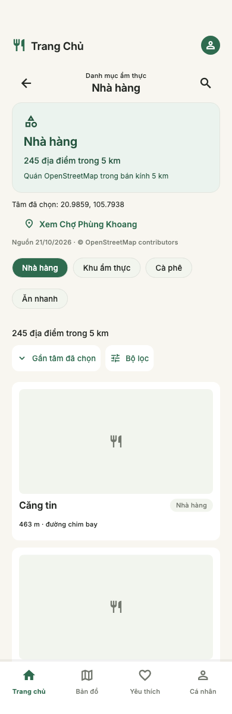
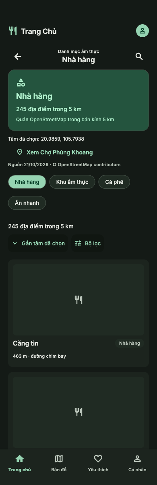

# T07 / R2 — Category dùng quán OSM thật

Cập nhật 23/10/2026 trên nhánh có sẵn `feat/category-ui`, rebase từ `dev`
đã merge Search. Phần UI ban đầu theo Stitch project `17045709860825880180`,
screen `62a9410c5de64bfdb4b431de07ff7ebd`. R2 giữ shell, Back, danh sách lazy,
form nháp và theme; thay banner ảnh demo bằng khối thông tin có nguồn.

## Dữ liệu và phạm vi

- Category dùng `osmSearchControllerProvider` → `OsmRegionSearchRepository`
  → chỉ mục gói OSM Hà Nội, cùng tâm khám phá với Home/Search/Map và bán kính 5 km.
  Chưa có GPS/tâm thủ công thì chờ người dùng chọn; không tải quán demo.
- Bốn danh mục lấy trực tiếp từ amenity OSM: `nha-hang` (Nhà hàng), `ca-phe`
  (Cà phê), `an-nhanh` (Ăn nhanh), `khu-am-thuc` (Khu ẩm thực).
  Tại tâm Chợ Phùng Khoang: 245 / 245 / 62 / 4 quán tương ứng với gói hiện tại.
- Gói hiện không có tag phân loại món. Các ID cũ như `mon-viet`, `pho`, `bun`,
  `banh-mi` có thông báo chưa hỗ trợ và lựa chọn loại quán có nguồn. Không đoán
  món Việt/Phở/Bún từ tên quán hoặc coi mọi restaurant là Món Việt.
- Scope từ path luôn AND với query/filter trước count/paging trên toàn tập 5 km.
  Metadata bộ lọc lấy trong scope; không đưa lựa chọn món con từ taxonomy demo
  vào form. ID sai không query. Repository từ chối scope món chưa hỗ trợ.
- Mặc định/reset dùng thứ tự gần tâm do repository OSM cung cấp. Rating/giá/
  nhiều review bị khóa; URL cũ mang sort/filter thiếu dữ liệu báo lỗi rõ ràng,
  người dùng có thể xóa điều kiện. Không xếp hạng từ vài card.
- Hiện tâm, ngày nguồn và attribution. Banner không dùng ảnh demo; ảnh quán thiếu
  dùng placeholder. Không hiện rating/giá giả hoặc thao tác lưu RAM cho quán OSM.
  Khoảng cách là đường chim bay từ tâm khám phá, không phải tuyến đường.

## Điều hướng và state

- Home có **Xem danh mục**, mở loại đang chọn hoặc Nhà hàng; giữ tìm/lọc nhanh cũ.
- Chuyển loại quán bằng các chip Category, thay route với ID ổn định.
- Card OSM mở Map bằng ID, dùng push để Back trả về Category và giữ cuộn/query.
  Detail chưa tích hợp nên chưa mở card OSM sang trang Detail nguồn demo.
- Form Cancel giữ request; Apply/Reset giữ scope từ path. Reset controller xóa
  query/filter và về thứ tự gần tâm. Đổi tâm giữ request hiện tại và bỏ response cũ.
- Bộ chọn quán Collections/Review vẫn dùng controller nguồn cũ theo đợt riêng;
  chuyển Category không đổi nguồn của các tính năng đó.

## Kiểm tra và giới hạn

- Test dùng chính asset OSM Hà Nội cho count, scope AND, pagination, tên không dấu,
  category không được hỗ trợ, loading/error/retry, đổi tâm và stale response.
- Kiểm tra Home → Category → Map → Back, Cancel/Apply/Reset, URL rating cũ,
  320/390/428 px, text scale 1.0/1.6, SafeArea và hai theme.
- Capture bằng `flutter test test/category_test.dart --dart-define=CATEGORY_CAPTURE=true`;
  ảnh dưới là widget render thật. Đây chưa phải nghiệm thu thao tác Android/iOS.
- OSM có thể thiếu quán hoặc thông tin cũ; số đếm là số POI trong gói, chưa phải
  xác nhận quán đang hoạt động. Detail/review/persistence theo các đợt sau.
- Kết quả CI và trạng thái R2 ở [REAL_DATA_R2_STATUS.md](REAL_DATA_R2_STATUS.md).

