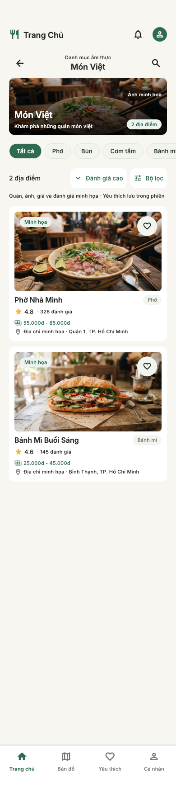
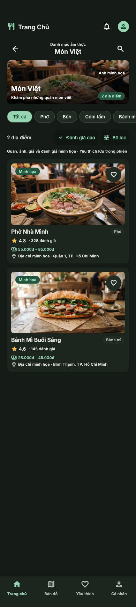

# T07 — Category Results

Ngày thực hiện: 19/10/2026. Nhánh `feat/category-ui`, từ dev đã có T08.
T07 là số task trong kế hoạch; thiết kế tương ứng là **17 - Category Results**.

## Nguồn và giao diện

Đã đọc ảnh và HTML qua Stitch MCP trong project `17045709860825880180`,
screen `62a9410c5de64bfdb4b431de07ff7ebd`.

Giữ header thương hiệu, thanh Back/tên danh mục/tìm kiếm, banner ảnh 126px tối thiểu,
chip món con cuộn ngang, thanh đếm/sort/filter, card ảnh lớn có padding và thanh bốn tab.
Hero/card tăng chiều cao khi chữ lớn; danh sách lazy và có SafeArea/keyboard/scroll.
Light/dark dùng Inter, token hiện tại; thêm onImage để chữ trên ảnh có scrim đọc được cả hai mode.

Các khác biệt so với prototype:

- Root “Món Việt” có **2 quán demo hiện có** (Phở Nhà Mình, Bánh Mì Buổi Sáng),
  không sao chép 24 quán hoặc bịa thêm nhà hàng Hà Nội. Cà phê nằm ngoài root này.
- Hero dùng ảnh minh họa từ assets sẵn có và luôn có nhãn; card giữ ảnh/giá/điểm/địa chỉ
  của repository. Không thêm huy hiệu verified, nổi bật, gia truyền, Obama hoặc khoảng cách chưa có nguồn.
- Không ghi “gần bạn nhất” khi chưa có GPS cho Category; mặc định sắp xếp đánh giá cao.
- Số quán là kết quả của truy vấn hiện tại; chưa có totalCount thì ghi số quán đã tải.
- Không đưa accordion QA mô phỏng empty vào sản phẩm; empty state hoạt động khi query thật không có kết quả.
- Header chính giữ chữ “Trang Chủ” và tab Home như thiết kế; chỉ một nút Back ở thanh ngữ cảnh.
- Trang chủ vẫn giữ tìm/lọc nhanh tại chỗ. Nút mới **Xem danh mục** mở T07 dựa trên danh mục
  đang chọn, mặc định Món Việt, để giữ hành vi Home đã có.

## Điều hướng và state

`/home → Xem danh mục → /categories/mon-viet → /restaurants/:id → Back`.
Route Category là sibling của Home trong cùng StatefulShellBranch: dùng đúng navbar hiện có,
không dựng shell thứ hai. Detail/form vẫn dùng root navigator hiện tại.

- Đổi tab rồi trở lại giữ route, query, filter và vị trí cuộn của Category.
- Back từ Detail giữ danh sách; Back từ Category trả về Home cùng trạng thái lọc nhanh.
  System Back hoạt động cả khi thanh ngữ cảnh đã cuộn khỏi màn hình.
- Deep link không có lịch sử thì Back về Home. ID không tồn tại có thông báo riêng và không query dữ liệu.
- Nút tìm kiếm hiện field trong danh mục; hỗ trợ không dấu và tên món, debounce/stale guard dùng chung Search.
- Chip Tất cả xóa điều kiện món con, vẫn giữ root. Chọn chip món con lọc một loại;
  form T06 cho phép nhiều loại trong cùng root.
- Cancel không thay đổi request. Apply giữ root, Reset xóa điều kiện và trả sort đánh giá cao,
  không xóa ràng buộc root. Form không cho chọn loại thuộc root khác.
- Favorite dùng provider RAM chung; không tự đánh dấu thích từ ảnh Stitch.
- Tải thêm có error/retry riêng, giữ các quán đã tải. Không tải toàn bộ backend để lọc ở widget.

## Taxonomy và truy vấn

`PlaceCategory` định nghĩa IDs/nhãn/tags ổn định của ứng dụng, không chứa số liệu nhà hàng.
IDs hiện có: mon-viet, ca-phe, an-nhanh, pho, bun, com, com-tam, banh-mi,
do-an-vat, do-nuong, lau, mon-chay. Danh mục không có quán demo hiển thị empty.

Root Món Việt chấp nhận tag Món Việt và các món Việt được khai báo trong taxonomy,
ví dụ Bánh mì dù primary category của quán là Ăn nhanh. Đây là quan hệ taxonomy,
không phải lấy toàn bộ quán rồi đổi nhãn cho giống thiết kế.

PlaceSearchRequest bổ sung `categoryScope`, đi qua URI query `scope`, copyWith/equality/hash.
Đường dẫn `/categories/:categoryId` luôn quyết định root, ghi đè query scope nếu có xung đột.
Controller giữ scope của seed kể cả Apply/Reset hoặc kết quả form có scope khác.

```text
withinRoot(categoryScope)
  AND anySelectedSubtype(categories)
  AND query / rating / price / amenities
  → sort → totalCount → cursor/limit
```

DemoPlaceRepository thực hiện ràng buộc trước sort/count/paging và từ chối ID scope sai.
Contract PlaceSearchRepository yêu cầu backend tương lai làm tương tự phía server;
không OR chung root với món con và không post-filter các trang đã tải.

## File chính

| File | Trách nhiệm |
| --- | --- |
| domain/place_category.dart | ID/taxonomy và nhận diện quán thuộc root |
| domain/place_search.dart, place_search_repository.dart | Scope và contract query AND/paging |
| data/demo_place_repository.dart | Áp dụng root cùng filter trước count/paging |
| presentation/category_screen.dart | Route state, banner, tìm/món con/sort/form, back và scroll |
| presentation/category_widgets.dart | Hero theo Stitch, ảnh minh họa và counter |
| presentation/search_results.dart | Kết quả lazy/loading/empty/error/pagination dùng chung với Search |
| presentation/search_controller.dart, search_filters_screen.dart | Giữ scope trong state và form Apply/Reset |
| shared/widgets/app_restaurant_card.dart, presentation/place_card.dart | Variant ảnh inset theo thiết kế; giữ favorite/navigation và variant cũ |
| core/router/app_router.dart, app_route.dart | Route thật trong branch Home và xử lý categoryId |
| presentation/home_screen.dart | Entry Xem danh mục, giữ lọc nhanh cũ |
| test/category_test.dart | Scope, navigation/state/form/error/paging/layout và capture |

Không thêm dependency hay sửa cấu hình native. Không thay đổi T08/GPS/DNS.

## Kiểm tra và giới hạn

- Flutter 3.47.5 / Dart 3.13.4: format sạch, analyze không lỗi,
  **115 tests pass** (19 test T07), `git diff --check` sạch.
  Chạy thêm `flutter test test/category_test.dart --dart-define=CATEGORY_CAPTURE=true`
  có 21 tests pass và xuất hai ảnh đối chiếu.
- Matrix 320/390/428, scale 1.0/1.6, SafeArea và light/dark; keyboard vẫn tìm được.
- Kiểm tra scope AND, count/paging, URI/family isolation, Reset/Apply,
  Home → Category → Detail → Back, tab state, sort, invalid/empty và retry.
- Ảnh dưới là widget render 390×1738 để đối chiếu với ảnh Stitch cùng kích thước;
  dùng font Inter/MaterialIcons và ảnh assets thật.
- iPhone 17 Pro simulator build/run/hot reload thành công. Hộp thoại Apple Account Verification
  vẫn che màn hình native; đã xem render tree của ứng dụng đang chạy qua Flutter inspector.
  Ảnh chứa tài khoản Apple không đưa vào repo. Chưa xác nhận thao tác tay qua UI native.
- Dữ liệu vẫn demo; chưa có Auth/Firestore và chưa có xác nhận duyệt UI của người dùng.




Thay đổi T07 được quản lý trên nhánh `feat/category-ui`; trạng thái commit/push xem lịch sử Git.
Tiếp theo: T09a — All Reviews, rồi T09b — Gallery.
