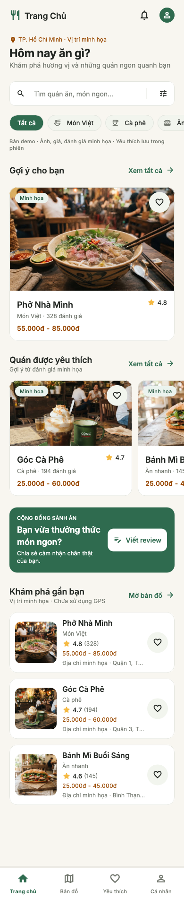
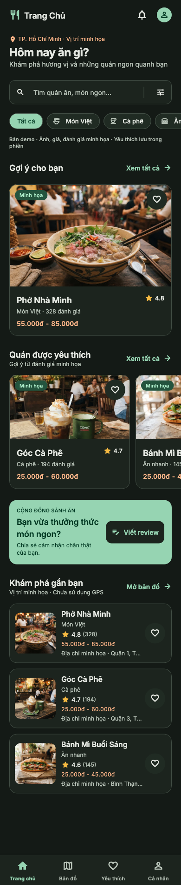

# Home theo Stitch — T03

Triển khai ngày 18/10/2026 trên `feat/home-ui`. Nguồn đọc bằng Stitch MCP:
[Food Review — Home](https://stitch.withgoogle.com/projects/17045709860825880180),
screen `be51296ba5444ed0b0fc92ac5495ad7a` (ảnh và HTML, thiết kế 390px).

## Phần đã triển khai

- `HomeScreen` thay màn khám phá cũ: header, lời chào/vị trí, tìm kiếm,
  danh mục ngang, gợi ý lớn với ảnh 16:10, danh sách ngang với ảnh 15:8,
  banner cộng đồng, danh sách quán, thanh điều hướng bốn tab 64px.
- Giữ Riverpod/repository, tìm theo tên, lọc danh mục tại chỗ, favorite trong
  phiên, route chi tiết theo ID và Back, trạng thái cuộn khi chuyển tab.
- Tái sử dụng AppSearchField, AppChip, AppRestaurantCard, AppRating,
  AppSectionHeader, AppImage, bottom sheet và theme Inter/light/dark.
- Loading, empty, lỗi/retry, ảnh thiếu/lỗi có fallback. Nội dung rộng tối đa
  680px, SafeArea, cuộn ngang/dọc và chữ phóng lớn 1.6x.
- Submit tìm kiếm / “Xem tất cả” mở Search với query/danh mục; filter mở T06;
  thông báo mở T23; avatar mở tab cá nhân; “Mở bản đồ” mở tab map.
  CTA review chọn quán trước khi mở đúng route T13.

## Dữ liệu và khác biệt có chủ đích

Repository mặc định vẫn là **DemoPlaceRepository**, chưa nối Firestore.
Giữ tên, ID và danh mục ba quán cũ để bảo toàn navigation và favorite.
Ảnh, giá, rating và số lượt đánh giá là **minh họa**, ghi rõ ngay trên Home.
Ảnh lưu offline tại `assets/images/demo/`; nguồn từ project Stitch:
ảnh phở/bánh mì từ Home, ảnh cà phê từ asset screen
`7df66e3c5aaf483baf70391c795e312c`. Ảnh không xác minh quán thực tế.

Vị trí mặc định là TP. Hồ Chí Minh, theo fixtures hiện có; không truy cập GPS,
không tính khoảng cách giả. Bỏ Michelin/giờ mở cửa/“Hot”/thông báo chưa đọc/
xếp hạng tuần vì chưa có dữ liệu chứng minh. Avatar dùng biểu tượng khách.
Palette linen/forest và Inter giữ theo design system của repository;
Stitch có nền xanh nhạt khác. Dark dùng theme sẵn có.

Giữ lọc danh mục tại Home theo yêu cầu bảo toàn chức năng; chưa chuyển sang
màn T07. Search T05, bộ lọc T06, map T08, review T13, thông báo T23 vẫn là
placeholder có thông báo chưa triển khai. Chưa triển khai Auth gate hay
đăng review; không có thông báo thành công giả.

## Kiểm tra và ảnh

- Flutter 3.47.5 / Dart 3.13.4.
- Format, `flutter analyze`, `flutter test` và `git diff --check`.
- Bộ kiểm tra Home: 320/390/428px, chữ 1.6x, light/dark; search/category/clear,
  giữ cuộn qua tab, chọn quán cho review, điều hướng CTA và ảnh thiếu.
- Đã chạy `flutter run` bằng main thật trên iPhone 17 Pro / iOS 26.3;
  build thành công và kết nối Dart VM. Hộp thoại Apple Account của simulator
  che giao diện; công cụ điều khiển Simulator timeout, nên chưa nghiệm thu
  tương tác trực tiếp trên thiết bị này.
- Ảnh dưới là render Flutter test 390×1900px với Inter/Material Icons thật,
  repository và assets mặc định, **không phải ảnh chụp native**.
  Đã đối chiếu ảnh và HTML Stitch, chỉnh khoảng cách, tỷ lệ ảnh,
  header/section, kích thước navigation và bố cục chữ lớn.

Tạo lại ảnh: `flutter test test/home_screen_test.dart --dart-define=HOME_CAPTURE=true`.
Kết quả ở `build/home-screenshots/`.

| Light | Dark |
| --- | --- |
|  |  |

Trạng thái: UI/demo đã triển khai và kiểm tra; chưa có xác nhận duyệt UI,
chưa hoàn tất backend/Auth/các task đích. Trạng thái commit/push xem lịch sử Git.
