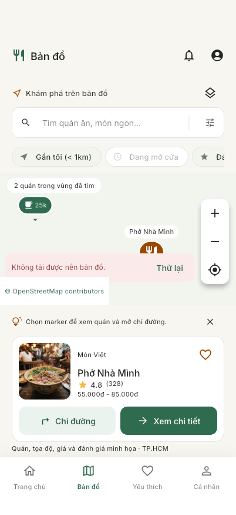
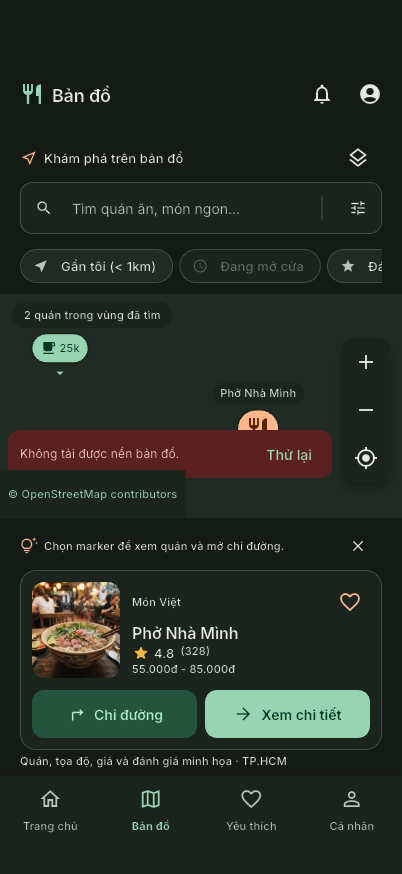

# T08 — Bản đồ

**Tích hợp dữ liệu thật R1 (22/10/2026):** Map mặc định đọc gói OSM Hà Nội từ
Geofabrik, tìm quán trong 5 km quanh tâm bản đồ và cho chọn Chợ Phùng Khoang khi
không có GPS. Rating/giá/favorite/chi tiết của quán OSM chưa nối backend nên không
hiển thị như dữ liệu thật. Số liệu, vùng hỗ trợ và phần chưa nghiệm thu ở
[REAL_DATA_R1_STATUS.md](REAL_DATA_R1_STATUS.md). Nội dung T08 bên dưới mô tả luồng
demo trước đây và được giữ để đối chiếu UI/kiểm thử cũ.

**Cập nhật nền bản đồ trước R1:** đã thay nền raster OSM bằng MapLibre/OpenFreeMap để bỏ
phụ thuộc tên miền tile OSM lỗi DNS. GPS tự lấy khi mở app, không có vị trí người
dùng mặc định. Xem [NATIVE_MAP.md](NATIVE_MAP.md) và [STARTUP_LOCATION.md](STARTUP_LOCATION.md).
Các nguồn thiết kế/ảnh và bằng chứng T08 bên dưới là lịch sử triển khai ban đầu.

Ngày thực hiện: 19/10/2026. Branch: `feat/map-ui`.
Phạm vi theo yêu cầu: thực hiện T08 trước T07. T07 vẫn chưa triển khai.

## Nguồn thiết kế và đối chiếu

Đã đọc ảnh và HTML qua Stitch MCP từ project `17045709860825880180`,
screen `2666320d6e65407ca829e5e53a8e2b83` — **Food Review — Map / 08 - Map**.
Không sửa thiết kế Stitch.

Giữ Inter, theme/token hiện có, header, ô tìm, dải chip ngang, marker giá xanh,
marker đang chọn màu secondary, bộ đếm, zoom/GPS, gợi ý có thể đóng, thẻ quán,
hai CTA và thanh điều hướng bốn tab của shell.

Các khác biệt có chủ đích:

- Header ghi “Bản đồ” theo tab hiện tại; ảnh Stitch ghi “Trang Chủ”.
- Dữ liệu demo hiện có ở TP.HCM; giữ nguyên ID/tọa độ/ảnh/giá/điểm, không bịa thêm
  quán Hà Nội, “18 quán”, Michelin, giờ mở cửa hoặc 6 phút đi bộ từ ảnh mẫu.
- Bản đồ thật dùng raster OSM, không dựng lại SVG Hồ Hoàn Kiếm như một bản đồ có dữ liệu thật.
  Nền bản đồ có màu gốc; các lớp UI hỗ trợ theme light/dark.
- Chưa cấp GPS thì không có chấm vị trí người dùng, khoảng cách hoặc chip gần tôi được bật sẵn.
  Khoảng cách sau GPS ghi rõ là đường chim bay; không giả thời gian đi bộ.
- Nút mic không xuất hiện khi chưa tích hợp giọng nói; chip mở cửa disabled với giải thích.
  Nút lớp bản đồ mở thông tin về lớp đường phố hiện có, không giả lớp vệ tinh.
- Vùng bản đồ và card tách nhau để attribution luôn thấy được. Màn thấp/chữ lớn/bàn phím
  hoặc nhiều thông báo chuyển sang cuộn, vẫn giữ nguyên instance camera bằng GlobalKey.

## Luồng và hành vi

`Home → tab Bản đồ` hoặc `Chi tiết → Chỉ đường → /map?restaurantId=...`.
ID hợp lệ tải qua repository, chọn đúng quán và đưa camera đến tọa độ quán.
ID sai/lỗi có thông báo/thử lại; vẫn kéo và tìm bản đồ được.

- Tìm tên quán/món không dấu với debounce 300 ms, xóa tìm kiếm, chip nhanh và form T06.
  Apply cập nhật request; Cancel giữ nguyên filter. Quy tắc lọc/giá giống Search.
- Kéo/zoom rồi bấm **Tìm vùng này** mới truy vấn vùng mới. Zoom từ 3–18,
  không phát query cho mọi frame khi kéo bản đồ.
- Query giới hạn 50 quán/vùng; `hasMore` thể hiện bằng dấu `+` trên bộ đếm.
  Backend cần query theo vùng/limit, không tải toàn collection xuống widget.
- Marker giá dựa trên giá thấp nhất đã có. Chọn marker cập nhật card và đưa quán vào vùng nhìn.
  Quán được chọn ban đầu là quán có điểm cao nhất trong kết quả vùng.
- Favorite dùng state RAM có sẵn, đồng bộ với Home/Detail/Favorites.
  Xem chi tiết dùng push, Back giữ query, selection và camera; indexed stack giữ state khi đổi tab.
- GPS lấy một foreground fix khi mở app và dùng chung Home/Map. Nút **Vị trí của tôi**
  hoặc **Gần tôi** cập nhật lại; chặn bấm trùng, timeout 15 giây, xử lý dịch vụ
  tắt/denied/deniedForever/lỗi. Không background location. Chưa có GPS thì không
  dùng camera mặc định; vẫn xem/tìm quán và mở bản đồ quán từ Chi tiết được.
  Xem [STARTUP_LOCATION.md](STARTUP_LOCATION.md).
- Gần tôi lọc bán kính dưới 1 km dựa trên fix vừa lấy; không tự cập nhật khi người dùng di chuyển.
- Chỉ đường mở URL Google Maps walking với tọa độ đích qua ứng dụng ngoài;
  không có turn-by-turn nội bộ. Lỗi mở link hiển thị thông báo an toàn.

## Các file và trách nhiệm

| File | Nhiệm vụ |
| --- | --- |
| `domain/place_map_repository.dart` | GeoPoint/khoảng cách, viewport, result, contract truy vấn vùng và vị trí, URL chỉ đường |
| `data/demo_place_repository.dart` | Lọc tọa độ hợp lệ/vùng/radius, dùng lại Search cho điều kiện/sort, áp dụng limit |
| `data/device_location_repository.dart` | Geolocator, quyền foreground, timeout, lỗi an toàn và mở cài đặt |
| `presentation/map_controller.dart` | Dependency injection, request/filter, debounce/stale-response guard, trạng thái GPS/lỗi |
| `presentation/map_screen.dart` | Camera/selection, query route, tìm vùng, filter draft, responsive và shell integration |
| `presentation/map_widgets.dart` | FlutterMap/tile/marker/attribution/retry, preview, favorite, detail và mở URL |
| `core/router/app_router.dart`, `app_route.dart` | Thay placeholder bằng `/map` thật, đọc restaurantId |
| `test/map_test.dart` | Spatial query, async state, GPS, navigation, filter, layout và lỗi |

Thêm `url_launcher` vì Flutter SDK và dependency hiện có không cung cấp mở ứng dụng ngoài.
Lockfile và native registrants được cập nhật. Không thêm key/secret/quyền location nền.

## Tile và backend (T08 ban đầu, đã thay nền)

T08 ban đầu dùng cấu hình tile OSM, URL HTTPS,
attribution luôn hiển thị và mở trang copyright. `NetworkTileProvider` giữ cache
built-in của flutter_map 8.3.2 theo HTTP headers, không tải offline/prefetch/bulk.
`panBuffer: 0` chỉ tải vùng cần hiển thị. Lỗi tile có thông báo và nút thử lại,
marker/card không phụ thuộc tải nền thành công.

Đối chiếu [OSM Tile Usage Policy](https://operations.osmfoundation.org/policies/tiles/).
Provider khác phải có URL/attribution/điều khoản tương ứng trước khi cấu hình phát hành;
không đổi tile URL sang nguồn khác rồi giữ attribution OSM nếu nguồn yêu cầu ghi công riêng.
Backend PlaceRepository cần implement thêm PlaceMapRepository với spatial index,
query vùng/filter/limit phía server và tọa độ hợp lệ. Repository không hỗ trợ spatial query
sẽ hiện lỗi rõ ràng, không âm thầm thay bằng demo.

## Kiểm tra và giới hạn

- Flutter 3.47.5 / Dart 3.13.4; format sạch, analyze không lỗi,
  **96 tests pass** (21 test Map), `git diff --check` sạch.
- Matrix 320/390/428, text scale 1.0 và 1.6, SafeArea, light/dark; keyboard đổi layout giữ camera.
- Tests dùng repository/location override và tắt tile network để có kết quả xác định.
- Build/run iPhone 17 Pro simulator thành công, hot reload thành công.
- Màn simulator bị hộp thoại Apple Account Verification che; ảnh bên dưới lấy trực tiếp
  render tree ứng dụng đang chạy qua Flutter inspector, không phải screenshot toàn màn iOS.
  Không đưa ảnh hộp thoại chứa tài khoản cá nhân vào repository.
- Host và simulator đều không resolve được `tile.openstreetmap.org` (`curl: (6)` /
  `SocketException: Failed host lookup`). Vì vậy ảnh render thể hiện **lỗi tải nền**,
  chưa xác nhận ngoại hình tile OSM trực tuyến. Không thay bằng bản đồ giả để che lỗi.
- GPS cấp quyền/thay đổi Cài đặt và mở ứng dụng chỉ đường chưa nghiệm thu trên thiết bị thực;
  kiểm tra tự động hiện xác nhận contract/state/UI khi thành công và thất bại.
- Quán vẫn là demo, Auth/Firestore chưa tích hợp; không coi đây là luồng backend hoàn tất.

Ảnh render iOS light/dark (có trạng thái lỗi DNS):

Thay đổi T08 được quản lý trên nhánh `feat/map-ui`; trạng thái commit/push xem lịch sử Git.
T07, T09a và T09b chưa triển khai. Lỗi DNS tải nền OSM tạm hoãn xử lý theo yêu cầu người dùng.
