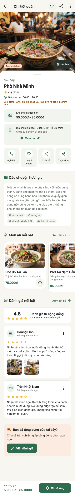
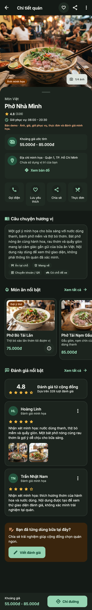

# Restaurant Detail — T04

Triển khai ngày 19/10/2026 trên `feat/restaurant-detail-ui`.
Nguồn đọc qua Stitch MCP: [Food Review — Restaurant Detail](https://stitch.withgoogle.com/projects/17045709860825880180),
screen `3431dafad3a54d85a0878f5acaf60be3`. Đã đọc ảnh và HTML; viewport đối chiếu 390×2553px.

## UI và dữ liệu

- Giữ route `/restaurants/:restaurantId`, provider tải theo ID và Back về nguồn;
  direct link không có lịch sử vẫn về Home qua RouteBackScope hiện có.
- Ảnh đầu trang lướt ngang, chỉ số ảnh, khối thông tin bo góc phía trên,
  tên/danh mục/rating/giờ phục vụ, giá và địa chỉ; thao tác nhanh;
  câu chuyện/tiện ích; món ăn ngang; tổng quan rating và tối đa hai review;
  CTA viết đánh giá; thanh giá/chỉ đường cố định phía dưới.
- Màn nằm trên root navigator: không lặp thanh bốn tab của Home. Thanh dưới là
  giá và CTA theo Stitch. SafeArea, nội dung tối đa 680px, cuộn dọc/ngang;
  chữ lớn chuyển thao tác/thanh dưới sang bố cục phù hợp.
- Tái sử dụng AppImage, AppBadge, AppRating/Summary, AppReviewCard,
  AppSectionHeader, AppButton/IconButton, bottom sheet, toast và theme Inter.
- AppRating hỗ trợ ẩn chữ số để tránh lặp điểm trong summary/card review.
  AppReviewCard không vẽ nút helpful/replies khi chưa có callback thực hiện.

Dữ liệu vẫn là **demo** qua repository; không có request Firestore trong widget.
Giữ nguyên ID, tên, danh mục, tọa độ, giá và rating từ Home. Thêm các field
Dart thuần tùy chọn cho Place: giờ phục vụ, tiện ích, menuItems và isDemo.
PlaceMenuItem chỉ mô tả món, không có nghiệp vụ đặt hàng.

Quán `pho-demo` có bốn ảnh, bốn món và hai review minh họa; các quán còn lại
hiển thị fallback cho dữ liệu chưa có. Ảnh mới được tải từ các thẻ img trong
HTML Stitch Detail, lưu offline ở `assets/images/demo/`: detail_hero,
dish_tai_lan, dish_nam_gau, dish_quay, dish_chin, review_pho_1, review_pho_2.
Ảnh chính của Home vẫn giữ ở đầu gallery để không đổi hình Home.

Review thêm authorName (tên công khai dạng snapshot), isDemo; chưa có badge
xác minh/hóa đơn hay thống kê phần trăm. DemoReviewRepository chỉ đọc preview,
không cho tạo review. `watchForPlace(placeId, limit: 2)` giới hạn dữ liệu tại
repository; T09a sẽ bổ sung danh sách đầy đủ và phân trang.
Review demo được ghi rõ ngay trên từng card. Count/rating tổng hợp vẫn là dữ
liệu mẫu của Place, không suy ra từ hai review preview.

Không sao chép các tuyên bố Michelin, di sản 70 năm, quán đang mở, đông khách,
khoảng cách/thời gian đi bộ, 96% hài lòng hay nhận xét có hóa đơn từ thiết kế.
Giờ phục vụ mẫu không được dùng để khẳng định quán đang mở tại thời điểm thực tế.
Palette linen/forest và dark dùng design system của repository.

## CTA và phụ thuộc còn thiếu

| Thao tác | Hành vi hiện tại |
| --- | --- |
| Back | Pop về nguồn; direct link fallback Home |
| Tim trên toolbar / Lưu yêu thích | Chung favoriteIdsProvider; lưu trong RAM và đồng bộ Home/Favorites |
| Ảnh / chỉ số ảnh | Mở T09b, truyền restaurantId và index bắt đầu từ 0 |
| Ảnh trong review | Mở T09b với restaurantId, index, source=review và reviewId; T09b hiện lấy đúng review và mở viewer |
| Thực đơn | Cuộn tới section món |
| Xem tất cả món | Bottom sheet danh sách món hiện có |
| Biểu tượng thông tin món | Bottom sheet ảnh/mô tả/giá; không phải nút đặt món |
| Gọi điện | Giải thích chưa có số điện thoại xác minh; chưa tích hợp dialer |
| Chia sẻ | Bottom sheet sao chép tên, địa chỉ và đường dẫn nội bộ qua Clipboard; chưa có public web link/system share |
| Xem tất cả review | Mở T09a đúng restaurantId |
| Tên/avatar tác giả | Mở T24 đúng userId |
| Tùy chọn nhận xét | Mở T25 với targetType=review, restaurantId, reviewId |
| Báo cáo quán | Mở T25 với targetType=place, restaurantId |
| Viết đánh giá | Mở T13 đúng restaurantId; T10 đã có Auth gate và returnTo, khách cần đăng nhập |
| Chỉ đường / Xem bản đồ | Chuyển tab Map với restaurantId; GPS, marker và chỉ đường thật chờ T08 |

Ở thời điểm task T04, T09a/T09b/T10/T13/T24/T25 chưa triển khai. Hiện T09a và T09b
đã có UI/demo; xem [ALL_REVIEWS_UI.md](ALL_REVIEWS_UI.md) và [GALLERY_UI.md](GALLERY_UI.md).
Route placeholder còn lại ghi rõ
task còn thiếu; không giả lưu backend, đăng review, chia sẻ hay gửi báo cáo.
Backend phải xác minh quyền và dữ liệu khi các luồng đó được triển khai.

## Kiểm chứng

- Flutter 3.47.5 / Dart 3.13.4; format, analyze, toàn bộ tests, diff check.
- Kiểm thử Home → detail → favorite → Back vẫn giữ dữ liệu/tìm kiếm;
  các test routing cũ từ Favorites và direct link vẫn chạy.
- T04 kiểm tra 320/390/428px, light/dark, chữ 1.6×, safe insets;
  favorite đồng bộ, ảnh vuốt/index/Back, menu cuộn/xem món,
  CTA giữ định danh, copy Clipboard, review report giữ cặp ID,
  loading/error/retry/not-found, dữ liệu thiếu/ảnh lỗi,
  lỗi review độc lập với quán và limit preview = 2.
- Đã `flutter run` bằng main thật trên iPhone 17 Pro Simulator / iOS 26.3,
  build thành công, kết nối Dart VM và hot reload. Hộp thoại hệ thống Apple
  Account Verification che giao diện, nên chưa xác nhận tương tác native.
- Ảnh dưới là **render Flutter test**, font Inter/Material Icons và assets
  thật, cùng repository mặc định, 390×2553px như ảnh thiết kế đã đọc.
  Đã đối chiếu các khối, spacing, tỷ lệ ảnh, màu/font, thanh dưới và dark.

Tạo lại ảnh:
`flutter test test/place_detail_test.dart --dart-define=DETAIL_CAPTURE=true`.
Kết quả ở `build/detail-screenshots/`.

| Light | Dark |
| --- | --- |
|  |  |

Trạng thái: UI/demo đã triển khai và kiểm tra; chưa có xác nhận duyệt của người dùng,
chưa hoàn tất backend và các task đích. Trạng thái commit/push xem lịch sử Git.
