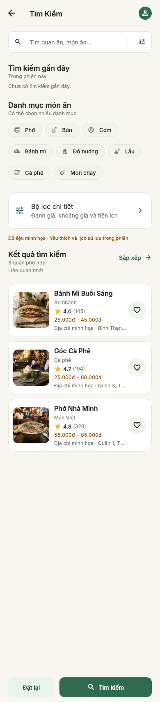
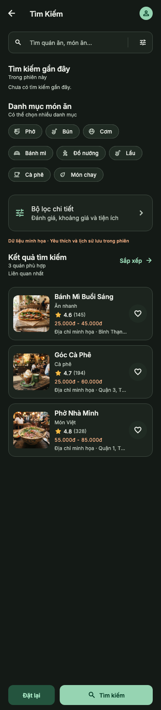
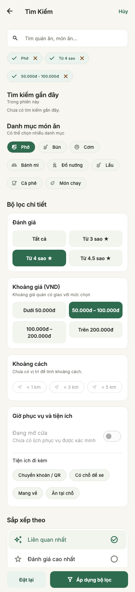
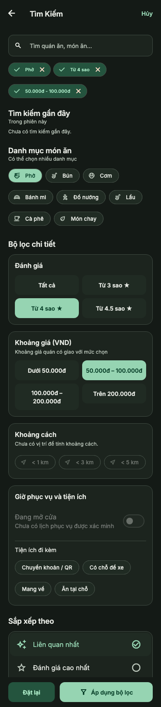
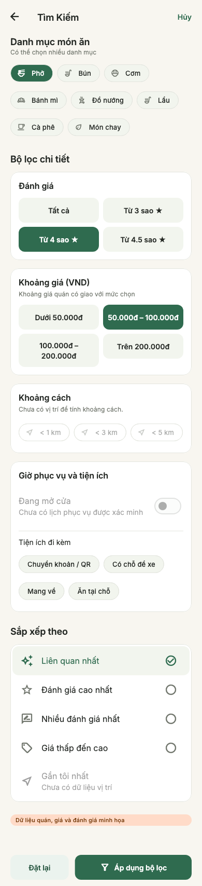
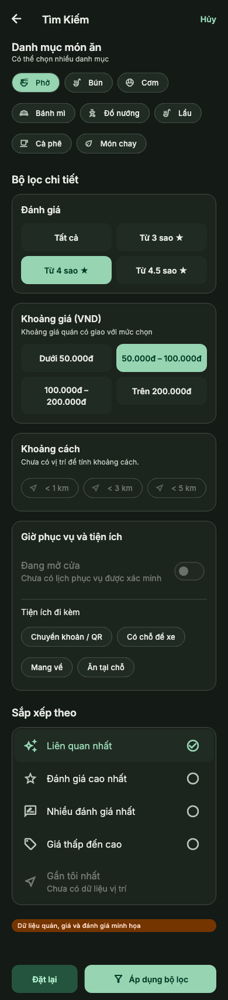

# Search và bộ lọc — T05–T06

Triển khai ngày 19/10/2026 trên `feat/t05-t06-search-ui`.
Nguồn đọc qua Stitch MCP: [Food Review — Search & Filter](https://stitch.withgoogle.com/projects/17045709860825880180),
screen `9a15d89afcc74574a93602f852a6c571`, ảnh + HTML. Ảnh tham chiếu 390×1707px.

Ảnh Stitch 04 là form lọc, không có danh sách kết quả. Người dùng đã xác nhận
làm **cả T05 và T06** trong cùng phạm vi. `/search/filters` bám bố cục form 04;
`/search` bổ sung kết quả bằng card dùng chung và cùng phong cách thiết kế.
Không sửa/generate lại Stitch; không triển khai Category T07 hay GPS T08.

## Hành vi

- `/search` nhận q, category, rating, minPrice, maxPrice, amenity, sort qua URL.
  category/amenity cho phép lặp parameter để biểu diễn nhiều lựa chọn.
- Tìm tên quán hoặc tên món có trong menu, không phân biệt hoa/thường/dấu
  tiếng Việt; chấp nhận cả chữ dựng sẵn và chuỗi dấu Unicode tách rời.
  Các từ trong query cùng xuất hiện trong tên quán/các tên món của quán.
- Nhập có debounce 300ms; submit tìm ngay. Query, filter, sort và cursor thuộc
  state Search riêng, không dùng state Home. Phản hồi cũ và trang cũ về muộn
  bị bỏ qua khi điều kiện đổi. Timer và controller được giải phóng khi rời màn.
- Kết quả có tổng số nếu repository cung cấp, loading/empty/error/retry,
  tải thêm có lỗi riêng; giữ kết quả hiện có khi tải trang tiếp theo lỗi,
  chặn tải trùng và khử ID trùng khi gộp trang.
- Card dùng PlaceCard/AppRestaurantCard; yêu thích đồng bộ Home/Detail/Favorites.
  Push detail theo ID; Back về Search giữ query, điều kiện và vị trí cuộn.
- Lịch sử gồm tối đa năm truy vấn thực sự submit/mở kết quả, chỉ trong phiên;
  chọn lại/xóa từng mục/xóa tất cả. Không seed lịch sử giả từ Stitch, chưa lưu
  vào thiết bị hay tài khoản. T10/T20 cần clear/reset khi triển khai auth/logout.
- Form lọc có bản nháp độc lập: Áp dụng mới cập nhật Search; Hủy/Back giữ bộ
  lọc đã áp dụng. Đặt lại trên form xóa điều kiện nháp nhưng giữ từ khóa;
  Hủy sau Đặt lại vẫn không đổi kết quả. Đặt lại trên Search xóa cả từ khóa và lọc.
- Home giữ quick search/category hiện có. Submit/Xem tất cả mở Search đúng q/category.
  Bộ lọc từ Home nhận q/category; Apply mở Search với lựa chọn mới, Cancel về Home.
- Direct link form không có lịch sử: Apply đi tới Search; Back fallback Home.
- Hai màn trên root navigator, không thêm tab thứ năm hay lặp thanh bốn tab.
  Thanh dưới theo Stitch là Đặt lại/Tìm kiếm hoặc Đặt lại/Áp dụng bộ lọc.

## Điều kiện đã hỗ trợ

| Điều kiện | Ý nghĩa |
| --- | --- |
| Danh mục | OR giữa các mục; khớp category chính hoặc foodCategories của quán |
| Điểm | Tất cả / từ 3 / 4 / 4.5; loại quán chưa có review khi lọc điểm |
| Giá | Khoảng minPrice–maxPrice của quán giao với khoảng chọn; quán thiếu giá không khớp bộ lọc giá |
| Tiện ích | Phải có tất cả tiện ích đã chọn; không suy diễn tiện ích chưa có thông tin |
| Sắp xếp | Liên quan / điểm cao / số review nhiều / giá thấp; ID làm tie-break ổn định; giá chưa rõ xếp cuối |
| Khoảng cách, gần tôi | Hiển thị disabled, chưa có vị trí/khoảng cách; không tính số km giả |
| Đang mở cửa | Disabled vì chuỗi giờ demo chưa phải lịch phục vụ theo ngày/múi giờ đã xác minh |

Giá dưới 50k dùng max=49.999đ; trên 200k dùng min=200.001đ. Điểm, giá và
sort sai định dạng trên URL trở về lựa chọn an toàn; khoảng min>max bị loại.
Bỏ chip đang áp dụng sẽ xóa đúng điều kiện đó. Badge filter phản ánh điều kiện thật.

## Kiến trúc và dữ liệu

Screen → PlaceSearchController/Riverpod → PlaceSearchRepository → implementation.
`DemoPlaceRepository` implement cả PlaceRepository (feed/detail) và capability
PlaceSearchRepository (query). Search không gọi fetchPlaces rồi lọc trong widget.
Nguồn place hiện có được tái sử dụng qua placeSearchRepositoryProvider;
nguồn chưa hỗ trợ search có thông báo rõ, không âm thầm lấy dữ liệu demo khác.

Contract `searchPlaces(request, cursor, pageSize)` trả PlaceSearchPage với items,
nextCursor, totalCount tùy chọn, taxonomy danh mục/tiện ích và cờ isDemo.
Default pageSize=20, demo giới hạn 1–50; cursor offset chỉ dùng nội bộ demo.
Form lấy metadata bằng một query pageSize=1 qua searchOptionsProvider, có lỗi/retry
riêng và không mất nháp. Khi nối Firestore/HTTP, phải áp dụng filter/sort/limit
ở backend, dùng cursor ổn định gắn với query; không dùng offset demo cho Firestore.
Metadata nên đến từ cấu hình/taxonomy, không tải toàn bộ quán để tính trong widget.

Vẫn chỉ có ba quán mẫu hiện tại, chưa nối backend thật. Thêm foodCategories
(Phở/Cà phê/Bánh mì) vào fixtures, giữ nguyên category/ID để không gãy Home.
Taxonomy demo gồm tám nhóm theo Stitch; nhóm chưa có quán trả rỗng đúng nghĩa.
Giá, ảnh, đánh giá và tiện ích là minh họa, ghi rõ trên Search/Form.
Không sao chép bộ lọc đang bật, số kết quả, khoảng cách hoặc tuyên bố Top 50 quán
độc quyền trong Stitch thành dữ liệu thật. Không tải thêm ảnh vì form không cần
asset mới và kết quả tái sử dụng ảnh hiện có.

Các file chính:

- domain/place_search.dart, place_search_repository.dart: request, page, sort,
  chuẩn hóa chuỗi và contract tìm kiếm.
- presentation/search_controller.dart: lifecycle query, debounce, phân trang,
  chống stale response, metadata và lịch sử trong phiên.
- presentation/search_screen.dart: kết quả và điều phối navigation.
- presentation/search_filters_screen.dart: nháp bộ lọc, Apply/Reset/Cancel.
- presentation/search_widgets.dart: recent/category/chip/sort/thanh hành động dùng chung.
- Router đăng ký hai route thật và bỏ trạng thái placeholder T05/T06.
  AppRoute.location hỗ trợ giá trị query dạng chuỗi hoặc danh sách để encode bằng Uri.

## Kiểm chứng và ảnh

Flutter 3.47.5 / Dart 3.13.4. Format, analyze, toàn bộ **75 tests** và diff check đã qua.
Các kiểm tra mới bao gồm search/menu không dấu, lọc kết hợp, cursor/sort ổn định,
URL round-trip, stale response, pagination retry/dedup, hủy timer, lịch sử;
Home→Search→Detail→Back, favorite, bản nháp Cancel/Apply/Reset,
metadata lỗi/retry, keyboard, safe insets và 320/390/428px × text 1.6 × light/dark.

Đã build và chạy main thật trên iPhone 17 Pro / iOS 26.3 Simulator, kết nối Dart VM
và hot reload. Hộp thoại Apple Account Verification che giao diện native, nên
chưa xác nhận tương tác trực tiếp trên simulator. Ảnh dưới là **render Flutter test**
với Inter/Material Icons, assets và repository thật của bản demo, cùng viewport
390×1707px như ảnh Stitch. Form có ảnh sau cuộn để kiểm tra phần sort/footer;
không nén chiều cao nội dung nhằm ép tất cả lựa chọn vào một ảnh.

Khác biệt có chủ đích: palette linen/forest theo design system repo; có Hủy;
lịch sử thật có thể rỗng; vùng chạm/chữ lớn được giữ; GPS/open-now chưa khả dụng;
không có banner thành tích chưa xác minh. Danh sách kết quả là bổ sung T05
vì ảnh Stitch chỉ cung cấp form lọc.

Tạo lại ảnh: `flutter test test/search_screen_test.dart --dart-define=SEARCH_CAPTURE=true`.
Kết quả ở `build/search-screenshots/`.

| Màn | Light | Dark |
| --- | --- | --- |
| Kết quả |  |  |
| Form lọc |  |  |
| Form sau cuộn |  |  |

Trạng thái: T05–T06 UI/demo đã triển khai và kiểm tra; chưa duyệt UI bởi người dùng,
chưa hoàn tất backend/GPS/Auth. Task tiếp theo theo kế hoạch là T07 — Category.
Chưa commit/push trong task này.
