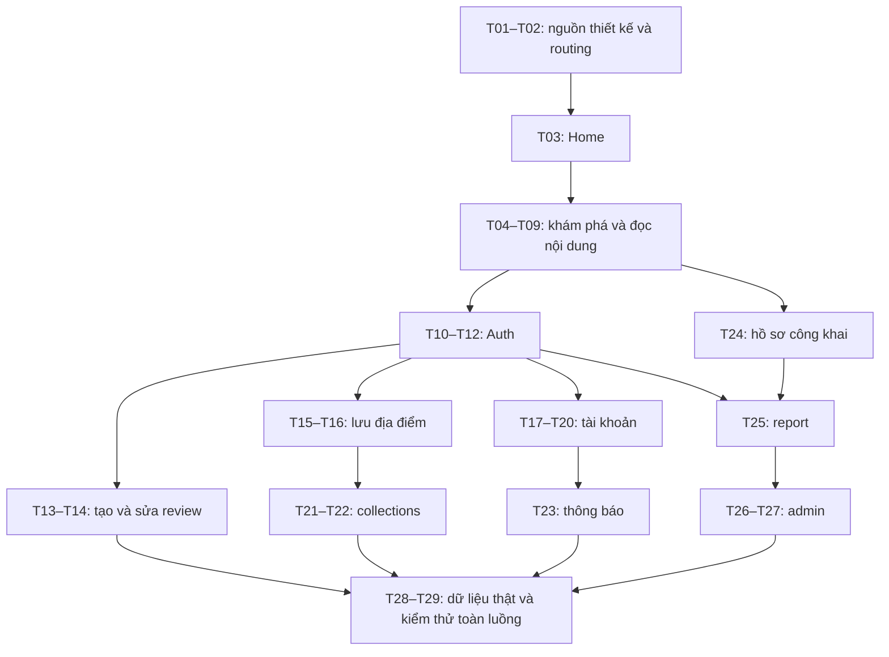

# Kế hoạch triển khai UI và luồng Food Review

Ngày đối chiếu: 20/10/2026. Trạng thái: T01–T02 đã hoàn thiện nền; T03–T17 đã có UI/demo; T10 Login, T11 Register, T12 Forgot Password, T13 Write Review và T14 Edit/Delete Review đã có UI/adapter, chưa nghiệm thu tài khoản thật/backend review. T07 được bổ sung sau T08 theo yêu cầu người dùng. T18 đã có UI/sửa tên-ảnh; username/bio/khu vực và nghiệm thu backend còn thiếu. T19 My Reviews đã hoàn thiện UI/phân trang theo user từ phần T14. T20 đã có UI Settings, chọn theme trong phiên và đăng xuất có xác nhận; thông báo đẩy/nội dung hỗ trợ chưa tích hợp. Task UI tiếp theo: **T21 — Collections**. Xem [SETTINGS_UI.md](SETTINGS_UI.md). Xem [EDIT_PROFILE_UI.md](EDIT_PROFILE_UI.md). Xem [LOGIN_AUTH_UI.md](LOGIN_AUTH_UI.md), [REGISTER_AUTH_UI.md](REGISTER_AUTH_UI.md), [FORGOT_PASSWORD_UI.md](FORGOT_PASSWORD_UI.md), [WRITE_REVIEW_UI.md](WRITE_REVIEW_UI.md), [MY_REVIEWS_UI.md](MY_REVIEWS_UI.md), [GALLERY_UI.md](GALLERY_UI.md), [ALL_REVIEWS_UI.md](ALL_REVIEWS_UI.md), [CATEGORY_UI.md](CATEGORY_UI.md), [MAP_UI.md](MAP_UI.md), [HOME_UI.md](HOME_UI.md), [RESTAURANT_DETAIL_UI.md](RESTAURANT_DETAIL_UI.md), [FAVORITES_UI.md](FAVORITES_UI.md) và [WANT_TO_VISIT_UI.md](WANT_TO_VISIT_UI.md) và [MY_PROFILE_UI.md](MY_PROFILE_UI.md). Kết quả đối chiếu và quyết định: [UI_FOUNDATION.md](UI_FOUNDATION.md).

## 1. Nguồn và cách hiểu phạm vi

- Đặc tả luồng: [food_review_luong_hoat_dong_routing.md](food_review_luong_hoat_dong_routing.md), đặc biệt các mục 2–11.
- Code hiện tại: router, app shell, các feature, repository contract và tests trong `lib/`, `test/`.
- Quy ước hiện tại: [ARCHITECTURE.md](ARCHITECTURE.md), [DESIGN_SYSTEM.md](DESIGN_SYSTEM.md), [BACKEND_SETUP.md](BACKEND_SETUP.md), [FEATURES.md](FEATURES.md).
- Stitch: [Vietnamese Food Review App](https://stitch.withgoogle.com/projects/17045709860825880180), project ID `17045709860825880180`. Đã đọc metadata project qua MCP và HTML của Home. Các màn còn lại mới đối chiếu tên/ID; phải đọc ảnh và HTML riêng khi bắt đầu task tương ứng.

Tài liệu này là kế hoạch triển khai. Phạm vi MVP, phần mở rộng có kế hoạch và ý tưởng dài hạn được quản lý tại [FEATURES.md](FEATURES.md). Checklist và cấu trúc mang tính đề xuất không tự cấp phép sửa code, đổi nghiệp vụ hoặc thao tác backend/Stitch ngoài task được yêu cầu.

Bao phủ toàn bộ luồng tài liệu, kể cả collections, reports và admin. Không tự bổ sung ba màn mở rộng 25, 26, 27 đã bị loại khỏi phạm vi. Số task trong kế hoạch là ID công việc độc lập với số màn Stitch.

## 2. Hiện trạng và khoảng cách

| Hạng mục | Đã có trong code | Cần thực hiện |
| --- | --- | --- |
| Design system | Tokens, Inter, light/dark, button/input/card/rating/overlay/navigation | Tái sử dụng, bổ sung chỉ khi màn cụ thể cần |
| Điều hướng | GoRouter, indexed stack 4 tab, auth refresh/guard, returnTo và Back nguồn | Nghiệm thu native/account thật và nội dung các màn còn thiếu |
| Home | `HomeScreen` theo Stitch; tìm tên, lọc danh mục, gợi ý, ảnh, favorite và giữ cuộn | Tách Search/Category thành màn riêng; nối dữ liệu thật và các CTA phụ thuộc |
| Chi tiết quán | UI T04: ảnh, thông tin, món, review preview, favorite, CTA và thanh giá/chỉ đường | Backend, Auth và nội dung thật của T08/T09/T13/T24/T25 |
| Dữ liệu quán | DemoPlaceRepository + PlaceSearchRepository query/filter/sort/cursor; Place có foodCategories | Backend query/index/cursor thật; dữ liệu quán có nguồn |
| Yêu thích | Repository RAM, auth gate, reset khi logout/đổi user, không auto-toggle sau login | Firestore theo tài khoản, async và rollback khi lỗi |
| Auth / profile | T10: form Login, Firebase adapter/session/guard/logout, tên/avatar Auth | Bật Email/Password/nghiệm thu thật; T11 đăng ký, T12 reset password, profile backend |
| Review | Model/contract + preview/list/form/edit/delete với repository demo owner-scoped | Firestore/rules, upload/retry ảnh thật, aggregate backend và nghiệm thu tài khoản |
| Firebase | `main.dart` initialize; Auth sign-in/out/session qua adapter T10 | Nghiệm thu Auth với tài khoản thật; Firestore chưa tích hợp |
| Search / Filter | T05–T06: query/filter/sort riêng, form nháp, danh sách/phân trang, recent trong phiên | Backend, dữ liệu GPS/open-now đáng tin cậy; xem SEARCH_UI.md |
| Category | T07: root scope, banner/chip/card ảnh lớn, tìm/lọc/sort/paging, giữ shell/Back | Backend taxonomy/query/index; xem CATEGORY_UI.md |
| Map | T08: OSM/marker/card, tìm theo vùng, filter, GPS foreground và chỉ đường ngoài | Backend spatial query; kiểm tra native GPS/chỉ đường; nền OSM bị lỗi DNS trong môi trường kiểm tra |
| Các feature khác | Chưa có UI chức năng tương ứng | want-to-visit, collections, notifications, reports/admin |

MVP và các đợt mở rộng được phân loại tại FEATURES.md. T16, T21–T27 thuộc phần mở rộng đã có kế hoạch; T28–T29 nghiệm thu theo phạm vi phát hành. Mốc 4–5 tuần cũ không áp dụng cho toàn bộ kế hoạch.

## 3. Các quyết định cần ghi nhận

Các mục dưới đây là mặc định đề xuất để lập kế hoạch; chốt trước task nghiệp vụ liên quan, không chặn việc dựng Home.

| Chủ đề | Đề xuất | Chốt trước |
| --- | --- | --- |
| Guest | Đọc Home/Search/Category/Map/Detail/Reviews/Gallery/Public profile; tab cá nhân và yêu thích hiện lời mời đăng nhập | T02, T10 |
| Hành động cần tài khoản | Viết/sửa review, favorite, muốn ghé, collections, sửa hồ sơ, thông báo, gửi report | T10–T13 |
| Sau đăng nhập | Giữ đích nội bộ và ngữ cảnh hành động; chỉ tiếp tục khi người dùng vẫn có quyền | T10 |
| Favorite / muốn ghé | Hai tập dữ liệu độc lập, không tự chuyển/xóa nhau; không tự nhập favorite demo vào tài khoản | T15 |
| Collections | Mặc định riêng tư trong giai đoạn đầu; không tự thêm chia sẻ/cộng tác | T21 |
| Review | Đề xuất một review/người/quán theo schema hiện có; sửa review cũ khi đã đánh giá | T13 |
| Giới hạn nội dung/ảnh | Chốt độ dài nội dung, số ảnh, dung lượng và loại ảnh; UI/backend dùng chung quy tắc | T13 |
| Report | Đề xuất yêu cầu đăng nhập; lý do bắt buộc, mô tả/ảnh tùy chọn | T25 |
| Admin | Backend xác minh role; xác định danh sách lý do/trạng thái và hành động hợp lệ | T26 |
| Tính năng chỉ thấy trên hình | Không tự thêm menu, huy hiệu, helpful, follow, bình luận, đặt bàn… thành nghiệp vụ chỉ vì mẫu thiết kế có nút | T01 và từng màn |

Nếu nút trong Stitch chưa có luồng trong tài liệu, task phải ghi rõ cách xử lý: nối với luồng đã có, dùng trạng thái chưa hỗ trợ hoặc bổ sung đặc tả. Không để nút trông hoạt động nhưng bấm không phản hồi.

## 4. Quy tắc thực hiện từng task

Mỗi lần làm một task UI có thể review độc lập:

1. Đọc ảnh + HTML đúng screen ID qua Stitch MCP; không sửa/generate thiết kế từ task code.
2. Ghi inventory các khối UI, CTA, dữ liệu cần thiết và trạng thái ngoại lệ.
3. Dựng Flutter bằng design system hiện có; dữ liệu qua Riverpod/repository, không nhúng cả danh sách trong widget.
4. Nối route/hành động trong phạm vi task. Đích chưa triển khai được ghi vào checklist phụ thuộc; chưa công nhận luồng hoàn chỉnh.
5. Chạy kiểm tra phù hợp; chụp màn thực tế và đối chiếu thiết kế ở cùng viewport. So sánh light với Stitch; dark theo theme thương hiệu hiện có.
6. Ghi kết quả: file thay đổi, screenshot, luồng đã chạy, phần còn dùng demo/backend và task phụ thuộc chưa xong.

Phân biệt hai mức: **UI đã duyệt** (render + tương tác bằng demo repository) và **luồng hoàn tất** (dữ liệu lưu/đọc thật, auth/quyền, lỗi mạng và điều hướng đã kiểm tra). Không đánh dấu hoàn tất nghiệp vụ chỉ vì màn đẹp hoặc hiển thị toast.

## 5. Thứ tự thực hiện

Đây là thứ tự ưu tiên; backend contract và implementation cần được làm cùng feature tương ứng. T28 là đợt rà soát tích hợp, không phải đợi tới cuối mới tính auth, phân quyền hoặc schema.

### Đợt A — Nền tảng và Home

#### T01 — Chốt nguồn thiết kế, dữ liệu và danh mục màn

- [x] Dùng bảng Stitch ở mục 7 để định danh màn; kiểm tra lại ID trước mỗi task.
- [x] Giữ brand tokens đã chọn trong `DESIGN_SYSTEM.md`; không đổi cả theme theo CSS sinh riêng của một screen.
- [x] Phân loại trường dữ liệu thật/demo/chưa hỗ trợ. `Place` đang thiếu giá, giờ mở cửa, tiện ích, badge; khoảng cách cần vị trí tham chiếu.
- [x] Chuẩn bị demo fixtures có ảnh và dữ liệu đủ cho các trạng thái, qua repository; không trình bày số liệu mẫu như dữ liệu thực.
- [x] Chốt danh sách CTA ngoài phạm vi và thiết kế còn thiếu.

**Đạt khi:** có mapping màn–route–data, tái sử dụng UI Kit, không phải viết lại core UI.

#### T02 — Khung 4 tab và quy tắc router

- [x] Nâng `AppShell` thành 4 branch theo đúng thứ tự tài liệu. Giữ stack riêng của từng tab.
- [x] Canonical routes theo tài liệu: `/home`, `/restaurants/:restaurantId`, `/login`; giữ redirect tương thích `/places`, `/places/:placeId`, `/sign-in` trong giai đoạn chuyển đổi.
- [x] Giữ model/feature `places` hiện tại; map `restaurantId` vào `placeId` tại biên route, không đổi tên toàn bộ dự án chỉ để khớp URL.
- [x] Thiết kế detail trên root navigator với `push` để các tab dùng chung một route chi tiết và Back về đúng nguồn. Deep link không có stack thì fallback về Home.
- [x] Chuẩn bị route names, return-to nội bộ hợp lệ và fallback not-found; không cho URL ngoài app làm đích redirect.
- [x] Đăng ký đích chưa có bằng màn trạng thái rõ ràng trong giai đoạn nối dần; không coi đó là UI đã hoàn tất. Route admin phải chặn mặc định.

**Đạt khi:** chuyển 4 tab giữ state; Back/deep link có quy tắc rõ; route cũ không gãy. Guard thật được nối ở T10.

#### T03 — Home `/home` — task UI đầu tiên

Nguồn: `02 - Home`, screen `be51296ba5444ed0b0fc92ac5495ad7a`.

- [x] Header/vị trí, lời chào “Hôm nay ăn gì?”, nút thông báo và avatar theo thiết kế; vị trí mặc định phải phân biệt với GPS thật.
- [ ] Search mở T05; nút filter mở T06; category chips mở T07.
- [x] Khối “Gợi ý cho bạn”: card nổi bật, ảnh, rating, metadata, nút favorite. Chỉ hiển thị badge/giờ/giá khi có dữ liệu hợp lệ.
- [x] “Quán được yêu thích”: danh sách ngang; tách state card và section, dùng widget chung.
- [ ] “Cộng đồng sành ăn”: CTA viết review cần chọn quán trước nếu chưa có `restaurantId`; sau đó đi qua auth gate. Không mở form thiếu quán.
- [x] “Khám phá gần bạn”: danh sách và CTA mở Map. Chưa cấp vị trí thì có trạng thái vị trí mặc định, không tính khoảng cách giả.
- [ ] Nối “Xem tất cả” với Search/Category có bộ lọc tương ứng. Nhãn “cao nhất tuần” cần nguồn thống kê tuần; nếu chưa có thì ghi nhận để thống nhất nội dung, không lấy favorite cá nhân thay thế.
- [x] Tách `HomeScreen`/các section theo cấu trúc feature, không kéo dài `PlacesScreen` thành widget chứa toàn bộ logic.
- [x] Loading/error/retry/empty/ảnh lỗi; guest và user; giữ scroll khi đổi tab.

**Đạt khi:** ảnh chụp đối chiếu đủ các khối Home, không overflow; card mở đúng quán. CTA đến feature chưa xong được theo dõi và kiểm chứng lại khi feature hoàn tất.

**Bằng chứng T03:** [HOME_UI.md](HOME_UI.md). Search/lọc danh mục tại chỗ được giữ theo yêu cầu; submit mở T05, filter mở T06; “Xem danh mục” mở T07 theo lựa chọn hiện tại. Auth gate và thống kê tuần chưa hoàn tất. UI đã kiểm tra bằng render/test, chưa có xác nhận duyệt của người dùng.

### Đợt B — Khám phá và đọc nội dung

| Task | Màn / route | Các việc trong task | Tiêu chí hoàn thành |
| --- | --- | --- | --- |
| T04 | Chi tiết quán `/restaurants/:restaurantId` | Nâng màn cũ: ảnh đầu trang, thông tin, rating, địa chỉ và section đúng Stitch; CTA review/gallery/map/save/report; thông tin thiếu có fallback | Load theo ID; error/retry/not-found; Back về Home/Search/Map/Favorites đúng nguồn; không giả nội dung chưa có |
| T05 | Search `/search` | Ô tìm, xóa query, danh sách kết quả, loading/empty/error; state query/filter/sort tách khỏi Home; xử lý request cũ về muộn | Nhập–xóa–lọc có kết quả đúng, mở chi tiết rồi Back giữ query và vị trí; dữ liệu lớn dùng query/phân trang repository |
| T06 | Bộ lọc `/search/filters` | Sheet hoặc màn theo Stitch; state nháp, Apply, Reset, Cancel; danh mục/điểm/giá/khoảng cách theo dữ liệu hỗ trợ | Cancel giữ filter cũ; Apply đổi kết quả; reset nhất quán; không bật filter mà dữ liệu chưa hỗ trợ |
| T07 | Category `/categories/:categoryId` | Title, danh sách quán, sắp xếp/lọc dùng lại Search components; xử lý ID danh mục | Không lẫn danh mục, empty/ID sai rõ ràng, Back giữ danh sách |
| T08 | Map `/map` | Bản đồ, marker, chọn marker/card preview, về vị trí của tôi, mở chi tiết; lọc theo vùng nếu nằm trong phạm vi | Từ chối GPS/tắt vị trí vẫn dùng được; không gọi vị trí nền; giữ marker/camera khi đổi tab; attribution và cấu hình tile phù hợp |
| T09a | All Reviews `/restaurants/:restaurantId/reviews` | Summary, danh sách, sort/filter đúng thiết kế và contract; avatar mở hồ sơ công khai, CTA viết review | Đúng quán; phân trang/loading/empty/error; không bịa phân bố số sao từ average |
| T09b | Gallery `/restaurants/:restaurantId/gallery` | Lưới ảnh, xem lớn, swipe, chỉ số ảnh ban đầu qua query `index`; xử lý ảnh hỏng | Tap ảnh thứ N mở đúng ảnh; kiểm tra index ngoài phạm vi; zero ảnh/Back đúng |

**Trạng thái T04:** UI/demo đã triển khai và kiểm tra; xem [RESTAURANT_DETAIL_UI.md](RESTAURANT_DETAIL_UI.md). Chưa nghiệm thu backend/Auth và các màn đích. T05–T06 đã được triển khai cùng nhau; xem [SEARCH_UI.md](SEARCH_UI.md).

**Trạng thái T07:** UI/demo đã bổ sung theo “17 - Category Results”; xem [CATEGORY_UI.md](CATEGORY_UI.md). Đã kiểm tra root scope/subtype, query/sort/form/paging, lỗi/empty/ID sai, favorite/Back/tab và layout light/dark. Chưa duyệt UI hay nghiệm thu backend.

**Trạng thái T08:** đã triển khai trước T07; xem [MAP_UI.md](MAP_UI.md). UI/demo và unit/widget tests đã kiểm tra; chưa duyệt UI, chưa nghiệm thu backend/GPS native. Build/run iOS thành công nhưng nền OSM bị lỗi DNS, tạm hoãn xử lý theo yêu cầu người dùng. T07 hiện đã bổ sung.

**Trạng thái T09a:** UI/demo theo “05 - All Reviews” đã triển khai: summary toàn quán,
histogram thật từ fixture, lọc/sort, cursor paging, lỗi/retry độc lập, link đúng ID và Back
giữ state. Đã kiểm tra light/dark, màn nhỏ/chữ lớn, build/run iOS và ảnh render;
xem [ALL_REVIEWS_UI.md](ALL_REVIEWS_UI.md). Chưa duyệt UI, chưa tích hợp backend/Auth;
write/profile/report vẫn là task riêng. Gallery T09b hiện đã có UI/demo.

**Trạng thái T09b:** UI/demo theo “07 - Restaurant Gallery” đã triển khai: featured,
lọc/lưới ảnh, viewer swipe/zoom, index đúng từ Detail/Review, share và Back giữ state.
Đã kiểm tra light/dark, màn nhỏ/chữ lớn, ảnh lỗi/empty/retry và build/run iOS;
xem [GALLERY_UI.md](GALLERY_UI.md). Chưa duyệt UI hoặc tích hợp backend/upload/lưu ảnh.
T10 Login/Auth, T11 Register, T12 Forgot Password và T13 Write Review đã triển khai; tiếp theo là T14 sửa/xóa review.

T09a và T09b là hai lượt UI riêng. Không cần làm đồng thời để hoàn thành một màn.

### Đợt C — Auth trước các thao tác cá nhân

| Task | Màn / route | Các việc trong task | Tiêu chí hoàn thành |
| --- | --- | --- | --- |
| T10 | Login `/login` | Email/password, show/hide, validation, loading/lỗi; links đăng ký/quên mật khẩu; Auth repository + provider + router refresh/guard; giữ return-to và action context | Khách bị chặn đúng hành động; login thành công quay lại đúng quán/luồng; Cancel không tự thực hiện hành động; auth loading không nháy màn private |
| T11 | Register `/register` | Tên/email/password/xác nhận theo thiết kế; validation; tạo account và profile có retry khi tạo profile lỗi | Không submit trùng; xử lý email đã dùng; không đăng ký lại account chỉ vì ghi profile thất bại; giữ ngữ cảnh từ Login |
| T12 | Forgot Password `/forgot-password` | Email, submit, trạng thái đã gửi, quay về login; bổ sung resetPassword vào contract Auth | Lỗi giữ dữ liệu; trạng thái thành công đúng phản hồi dịch vụ; không khẳng định đã nhận email |

Auth gate ưu tiên giữ ý định, không tự gửi review/report hoặc tự xác nhận thao tác sau đăng nhập. Với favorite/want-to-visit, chốt rõ có tiếp tục đúng một lần hay để người dùng xác nhận lại; kiểm tra không toggle hai lần.

**Trạng thái T10:** UI theo “13 - Login”, FirebaseAuthRepository cho sign-in/out/session,
validation/loading/error/retry, links T11/T12, router refresh/guard và returnTo đã triển khai.
Favorite yêu cầu đăng nhập và chạm lại tim để xác nhận; RAM reset khi logout/đổi user.
Đã kiểm tra UI light/dark/màn nhỏ/keyboard và build/run iOS; xem [LOGIN_AUTH_UI.md](LOGIN_AUTH_UI.md).
Chưa duyệt UI, chưa xác minh Console/tài khoản thật hoặc Firestore; không coi đây là
nghiệm thu production. T11 Register đã triển khai theo “14 - Register”; xem
[REGISTER_AUTH_UI.md](REGISTER_AUTH_UI.md). Tiếp theo: **T12 — Forgot Password**.

**Trạng thái T11:** UI theo “14 - Register”, tạo Firebase Auth account, cập nhật
displayName, validation, điều khoản, loading/error/retry, route returnTo/action và
liên kết Login đã triển khai. Đã kiểm tra light/dark, 320/390/428px, chữ lớn, bàn phím
và lỗi/retry; Firestore profile document và tài khoản thật vẫn chờ nghiệm thu.

**Trạng thái T12:** UI theo “15 - Forgot Password”, reset password qua Auth contract/provider/Firebase adapter,
trạng thái gửi thành công chung, retry và giữ `returnTo`/`action` đã triển khai. Đã kiểm tra light/dark,
màn nhỏ, text scale, lỗi và submit trùng; Firebase Console/email thật vẫn chờ nghiệm thu. Xem [FORGOT_PASSWORD_UI.md](FORGOT_PASSWORD_UI.md).

**Trạng thái T13:** UI theo “Food Review — Write Review”, form sao/nội dung/tag/ảnh/ngày ghé/người đi cùng,
auth guard, submit chống trùng và demo repository lưu trong RAM đã triển khai. Đã kiểm tra light/dark,
320/390/428px, text scale, validation và quay về màn nguồn; upload backend, Firestore và quyền sở hữu review vẫn chờ tích hợp. Xem [WRITE_REVIEW_UI.md](WRITE_REVIEW_UI.md).

**Trạng thái T14:** UI theo “18 - My Reviews”, danh sách review theo phiên, menu sửa/xóa, dialog xác nhận,
owner-scoped lookup, edit prefill qua form T13 và demo repository update/delete đã triển khai. Đã kiểm tra
owner mismatch, not-found, auth refresh/error, edit, delete và route có `restaurantId`; backend Firestore/rules,
upload ảnh thật và đồng bộ aggregate vẫn chờ tích hợp. Xem [MY_REVIEWS_UI.md](MY_REVIEWS_UI.md).

### Đợt D — Review và nội dung của người dùng

#### T13 — Viết đánh giá `/restaurants/:restaurantId/reviews/create`

- [ ] Đọc `06 - Write Review`; header quán, chọn sao, nội dung, ảnh preview/remove, nút đăng và validation.
- [ ] Load quán theo ID; auth gate trước form; user ID lấy từ phiên đã xác thực.
- [ ] Upload service riêng, tiến trình từng ảnh, lỗi/retry và chống submit lặp.
- [ ] Nếu upload thành công nhưng lưu review lỗi, giữ draft/URL ảnh đã có; retry không đăng hai review hoặc tải lại tất cả ảnh vô điều kiện.
- [ ] Confirm khi rời form có thay đổi; không làm mất draft vì lỗi mạng.
- [ ] Lưu thành công refresh detail/list/my reviews; quay đúng nguồn đã mở, có xác nhận thành công.

**Đạt khi:** đăng và đọc lại được đánh giá; loading và lỗi upload/lưu riêng; không có toast “đã đăng” khi mới lưu local demo.

#### T14 — Sửa/xóa đánh giá `/my-reviews` và `/reviews/:reviewId/edit`

- [x] Dùng lại form T13 ở mode edit, prefill; lấy review bằng repository theo cặp `(placeId, reviewId)` và xác minh owner.
- [x] Thêm My Reviews, menu edit/delete, query `restaurantId` bắt buộc cho route edit và trạng thái not-found/không có quyền.
- [x] Xác nhận trước xóa, giữ/xóa ảnh đã có trong demo, loading/error, refresh danh sách và test owner mismatch.
- [ ] Nối Firestore/rules, upload ảnh thật và thống kê rating backend.

**Đạt UI/demo:** user B không mở được form review của A; review của mình mở đúng quán; hủy/lỗi giữ dữ liệu, thành công cập nhật danh sách. Quyền backend và dữ liệu thật vẫn là phần tích hợp sau.

### Đợt E — Lưu địa điểm và tài khoản

| Task | Màn / route | Các việc trong task | Tiêu chí hoàn thành |
| --- | --- | --- | --- |
| T15 | Favorites `/favorites` | Đã triển khai theo Stitch 09; guest CTA; list, tìm/lọc/sort; async favorite contract theo user, lưu/bỏ từ mọi card | Đạt UI/demo; Home/detail/list đồng bộ; lỗi ghi hoàn tác; adapter hiện lưu RAM, backend/persistence sau |
| T16 | Want to Visit `/want-to-visit` | Đã triển khai theo Stitch 10; danh sách độc lập, bookmark thêm/bỏ từ Detail và lối vào từ Favorites/Profile, tìm/sort | Đạt UI/demo; hai list độc lập; auth/empty/error đầy đủ; adapter hiện lưu RAM, backend/persistence sau |
| T17 | My Profile `/profile` | Đã triển khai theo Stitch 11; guest/user variants, avatar/tên, links edit/my reviews/collections/notifications/settings/want-to-visit và trạng thái auth | Đạt UI/demo; danh tính lấy từ session; số liệu thiếu hiển thị `—`; các task editor/settings/backend còn lại giữ nguyên |
| T18 | Edit Profile `/profile/edit` | Đã có UI Stitch 12; prefill tên/ảnh, validation, upload Cloudinary, cancel/save qua Firebase Auth | Hoàn tất UI/phần tên-ảnh; Profile và review mới dùng danh tính cập nhật; review cũ giữ snapshot. Username/bio/khu vực và nghiệm thu tài khoản thật còn thiếu; xem EDIT_PROFILE_UI.md |
| T19 | My Reviews `/my-reviews` | Đã hoàn thiện UI Stitch 18 từ T14; summary/filter/cursor paging theo user; chọn quán viết bài; xem quán/edit/delete/gallery; bottom navigation chung | Đạt UI/demo; chặn stale/sai owner; mutation refresh; retry/empty/auth/light-dark; Firestore/rules/upload ảnh review vẫn chờ tích hợp |
| T20 | Settings `/settings` | Đã có UI theo Stitch 19, chọn light/dark/system trong phiên, hồ sơ/reset password, logout + confirm; xem [SETTINGS_UI.md](SETTINGS_UI.md) | Test reset user state/draft và route stack; không xóa backend; push/support/privacy disabled có lý do; theme chưa lưu qua restart |

T15 đã chuyển `FavoriteRepository` sang stream/async theo `ARCHITECTURE.md`; không gọi Firestore trực tiếp trong widget. Adapter hiện lưu RAM, nên persistence sau restart và Firestore thuộc phần tích hợp tiếp theo. Chính sách lưu theme qua restart là task nhỏ trong T20 nếu chọn hỗ trợ.

### Đợt F — Collections, thông báo và hồ sơ công khai

| Task | Màn / route | Các việc trong task | Tiêu chí hoàn thành |
| --- | --- | --- | --- |
| T21 | Collections `/collections` | Danh sách, thumbnail/count, empty, tạo mới; vào chỉnh sửa collection bằng ID; collection repository/state theo owner | Chỉ dữ liệu tài khoản hiện tại; đếm từ membership đúng; không trộn favorite/want-to-visit |
| T22 | Collection Editor `/collections/create`, `/collections/:collectionId/edit` | Một form hai mode; tên/mô tả nếu hỗ trợ, chọn/tìm/thêm/bỏ quán, validation và save; cần bổ sung layout vì chưa thấy screen riêng | Create tạo đúng một collection; Edit không tạo bản sao; Cancel không ghi; membership không trùng và quyền owner được kiểm tra |
| T23 | Notifications `/notifications` | List, read/unread, empty/error, mở target qua loại + ID; cập nhật trạng thái đọc | Target bị xóa có thông báo hợp lý; không lấy URL tùy ý làm route; không yêu cầu push permission chỉ để xem list |
| T24 | Public Profile `/users/:userId` | Avatar, public stats, reviews theo thiết kế; review mở quán; menu report đúng target | Không hiển thị email/field riêng; guest đọc được public data theo chính sách; not-found/nội dung bị ẩn có xử lý |

Không thêm màn Collection Detail riêng ngoài đặc tả. Trước mắt chọn collection vào editor; nếu cần chế độ xem riêng thì bổ sung đặc tả sau. Notifications ở đây là inbox trong app; push notification cần phạm vi và dịch vụ gửi riêng, chưa mặc nhiên nằm trong task.

### Đợt G — Report và quản trị

#### T25 — Report `/reports/create`

- [ ] Dựng từ `23 — Report Content`: ngữ cảnh target, lý do, mô tả/ảnh tùy chọn, nút gửi.
- [ ] Chốt contract `targetType` + định danh đủ duy nhất của restaurant/review/user; UI không dùng tên hiển thị làm ID.
- [ ] Auth gate theo quyết định mục 3; kiểm tra target, lý do và giới hạn dữ liệu; upload theo cơ chế T13.
- [ ] Loading chống gửi lặp, lỗi giữ dữ liệu; thành công quay về nguồn, chỉ thông báo “Đã gửi báo cáo”.

**Đạt khi:** mở từ quán/review/profile đúng target; không tạo báo cáo trùng vì double tap; không hiển thị đã kiểm duyệt khi mới gửi.

#### T26 — Admin danh sách `/admin/reports`

- [ ] Chưa thấy screen admin có nhãn trong metadata Stitch; cần layout bổ sung theo UI Kit trước khi duyệt UI.
- [ ] Danh sách, lọc trạng thái, phân trang và mở report theo ID; màn unauthorized riêng.
- [ ] Backend cung cấp role/quyền và dữ liệu report; route guard chỉ hỗ trợ UX, không thay bảo mật.

**Đạt khi:** guest/user thường bị chặn cả direct link và API; không dùng số liệu mẫu làm thống kê thật.

#### T27 — Admin chi tiết báo cáo

- [ ] Đề xuất route bổ sung `/admin/reports/:reportId` để thể hiện màn đã có trong flow mục 9 nhưng thiếu trong bảng route nguồn. Đây là bổ sung route cho chức năng đã mô tả, không phải tự thêm các màn mở rộng 25–27.
- [ ] Hiển thị target, lý do, minh chứng, trạng thái và lịch sử; chuyển đang xem xét / từ chối / đã xử lý.
- [ ] Ẩn nội dung có confirm; hủy giữ nguyên; backend xác minh trạng thái chuyển và ghi audit gồm actor/time/action.
- [ ] Loading/error/retry, xử lý report đã được admin khác cập nhật; đồng bộ danh sách sau thành công.

**Đạt khi:** chỉ backend có quyền cập nhật moderation; không xóa vĩnh viễn mặc định; report ID sai/target đã xóa không làm hỏng màn.

### Đợt H — Tích hợp và nghiệm thu

#### T28 — Rà soát dữ liệu thật theo feature

- [ ] Quán: query, paging, category IDs, giá/giờ/toạ độ/ảnh, nguồn các section Home; không suy đoán thống kê tuần từ average.
- [ ] Review: lookup ID, owner, upload, aggregates backend và phản ánh nội dung bị ẩn.
- [ ] Private data: favorite, want-to-visit, collections, inbox theo user; public profile tách field riêng tư.
- [ ] Reports/admin: schema, trạng thái, quyền, audit, chống gửi lặp; lỗi phải đi qua error mapper an toàn.
- [ ] Auth/Firestore rules: guest/owner/user khác/admin; verify qua emulator trước release.
- [ ] Đối chiếu Firebase bootstrap native đã có; Web chưa có FirebaseOptions. Chọn môi trường QA có thể khởi động thực tế; nếu cần web demo thì bổ sung bootstrap phù hợp.

**Đạt khi:** các UI đã duyệt đều có trạng thái dữ liệu rõ ràng và các hành động được hỗ trợ lưu/đọc lại sau restart; cập nhật README/FEATURES theo tình trạng thật.

#### T29 — Kiểm thử toàn luồng và đối chiếu UI cuối

- [ ] Guest: Home → Search → Filter → Category/Detail → Reviews/Gallery; Map → Detail → Back giữ map.
- [ ] Guest → viết review → Login → đúng form/quán; Cancel login không tạo tác dụng phụ. Đăng ký/quên mật khẩu giữ ngữ cảnh.
- [ ] Review: tạo/sửa/xóa, ảnh lỗi một phần, lưu lỗi, double submit, draft khi Back, quyền account A/B.
- [ ] Favorite/want-to-visit/collections độc lập; mọi entry point đồng bộ; logout/login B không lộ cache A.
- [ ] Profile/edit/settings/notifications/public profile/report; target xóa hoặc nội dung bị ẩn.
- [ ] Admin: unauthorized, xử lý cùng report từ hai phiên, hủy confirm, ghi audit và phản ánh nội dung đã ẩn.
- [ ] 4 tab giữ stack/scroll/filter, direct link và ID sai, Back từ root, reselect tab có hành vi đã thống nhất.
- [ ] UI ở 320px/390px/428px, text scale lớn, light/dark, keyboard, safe area, ảnh lỗi và giảm chuyển động.
- [ ] Format, analyze, test; bổ sung test cho hành vi auth/router/state/form mới, giữ các test có sẵn sau migration route. Kiểm tra native GPS/chọn ảnh/upload trên Android/iOS có sẵn.

**Đạt khi:** checklist có bằng chứng chạy thực tế; phần chưa kiểm chứng được ghi rõ, không ghi pass dựa trên kế hoạch.

## 6. Các phụ thuộc cần làm đúng lúc

| Hợp đồng / dữ liệu | Cần trước task | Thay đổi dự kiến |
| --- | --- | --- |
| Place/Search | T03–T08 | Query/filter/sort, category ID, paging; trường tùy chọn giá/giờ/tiện ích; nguồn dữ liệu section Home |
| Review read | T04, T09a, T24 | Summary đầy đủ, list paged, user public data; dùng demo có contract trước backend nếu cần |
| Auth | T10 | Auth implementation, session loading, reset password, return-to và reset state theo user |
| Review write / media | T13–T14 | Lookup/edit/delete/my reviews; quy tắc định danh và upload/retry |
| Saved lists | T15–T16 | Async repo theo user; favorite và want-to-visit riêng biệt |
| Profile/settings | T17–T20 | Public/private profile, update fields hợp lệ, theme persistence nếu chọn |
| Collections | T21–T22 | Collection ID/owner/membership; create/update và giới hạn dữ liệu |
| Notifications | T23 | Recipient, readAt, target type/ID, paging; xác định nguồn tạo thông báo |
| Reports/admin | T25–T27 | Target, reason, attachment, status, role, audit và state transitions |

Các mục này là đề xuất contract, chưa phải schema backend đã triển khai. Duy trì hướng phụ thuộc Screen → Provider → Repository; không chuyển toàn bộ `features/places` thành `restaurants` hay chuyển router thư mục chỉ để giống cây ví dụ trong tài liệu nguồn.

## 7. Mapping Stitch ổn định

Số ở nhãn là tên hiện có trên Stitch, không dùng làm định danh nghiệp vụ. Screen ID dưới đây dùng với `get_screen`, resource prefix `projects/17045709860825880180/screens/`.

| Nhãn Stitch | Screen ID | Task |
| --- | --- | --- |
| 01 - UI Kit | `53a46cee31ef40fb91a52aa0b6dda3fd` | T01, tái sử dụng core đã có |
| 02 - Home | `be51296ba5444ed0b0fc92ac5495ad7a` | T03 |
| 03 - Restaurant Detail | `3431dafad3a54d85a0878f5acaf60be3` | T04 |
| 04 - Search & Filter | `9a15d89afcc74574a93602f852a6c571` | T05 |
| 05 - All Reviews | `83d6c45771db47f4ad73ed324b9b4f32` | T09a |
| 06 - Write Review | `b8c315ebb4b24143be33f83744c49bdb` | T13, tái sử dụng T14 |
| 07 - Restaurant Gallery | `5de6740efe3f4995b875f518c83b2680` | T09b |
| 08 - Map | `2666320d6e65407ca829e5e53a8e2b83` | T08 |
| 09 - Favorites | `e33fd35596124197a819fe91c542cf8f` | T15 |
| 10 - Want to Visit | `f2d9a2440a094837a6446842725772f3` | T16 |
| 11 - My Profile | `90955d97ade5418f8ce5c32e2202ee8b` | T17 |
| 12 - Edit Profile | `4d24d4281759472db0108f64370d34ea` | T18 |
| 13 - Login | `31ae3b9abb2b4e2d81bbefdf14ba05e6` | T10 |
| 14 - Register | `1bc1d0042a40439b82bbf713483971dc` | T11 |
| 15 - Forgot Password | `f9d97df3f6384637adad3124a6038d80` | T12 |
| 16 - Filter & Sort | `a87b4c890dc54efcb910371f3fe12c59` | T06 |
| 17 - Category Results | `62a9410c5de64bfdb4b431de07ff7ebd` | T07 |
| 18 - My Reviews | `668cfe121c04455683c4b017a1990319` | T19 |
| 19 - Settings | `74348ac3dfde4af39bf85773df28f817` | T20 |
| 20 - Notifications | `97078d4659e548e89f49e0c2d3c10ef7` | T23 |
| 21 - Public Reviewer Profile | `9f6b48808f0d40d690cbf20e6c33b532` | T24 |
| 22 - Collections | `e69e9a4187db4b23b0025c6237e8f3cd` | T21 |
| 23 — Report Content | `14a53993bfc748efb8b18252d0f148f3` | T25 |

Global Design System là asset `assets/8f45df058264439b96fa58219b76fbd0`, không phải screen. Không dùng các instance “Generating Image…” hoặc màn ẩn “Generating Screen…” làm thiết kế chuẩn. Editor bộ sưu tập, guest variants, form edit review và admin cần bổ sung/điều chỉnh layout theo feature; chưa xác nhận có thiết kế riêng trong Stitch.

## 8. Cách bắt đầu và theo dõi

Lượt đầu: T01 → T02 → T03, hoàn thiện nền điều hướng vừa đủ và Home trước. Sau đó làm lần lượt T04 → T05 → T06 → T07 → T08 → T09a → T09b. Không triển khai đồng loạt mọi màn chỉ để tạo đủ file.

Mỗi task ghi 5 trạng thái: chưa làm / đang làm / UI đã duyệt / chờ tích hợp / luồng hoàn tất. Một task chỉ chuyển trạng thái theo bằng chứng; checkbox chỉ được đánh dấu ở T01–T02 đã thực hiện; các task UI tiếp theo vẫn chưa hoàn thành.

Mẫu yêu cầu thực hiện một lượt:

> Thực hiện T03 trong docs/UI_IMPLEMENTATION_PLAN.md. Đọc lại Home qua Stitch MCP, kiểm tra T01–T02 đã đủ chưa và hoàn thiện phụ thuộc cần thiết. Sửa code Flutter hiện tại, đối chiếu screenshot với thiết kế, báo kết quả kiểm tra và phần chưa tích hợp. Phạm vi lượt này là Home và nền cần thiết cho Home.
