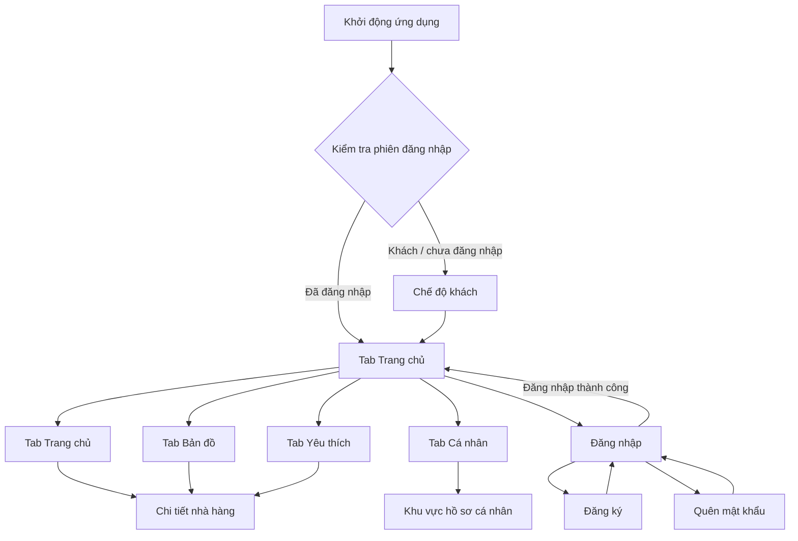
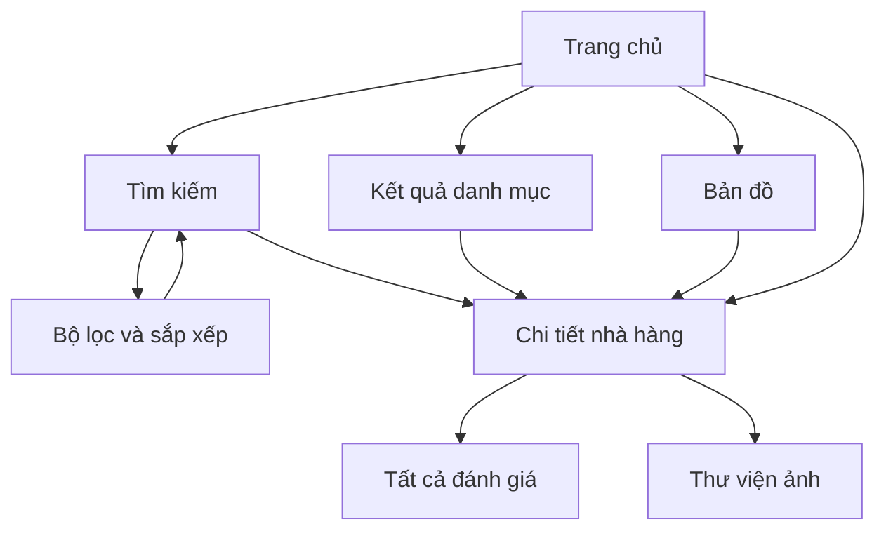
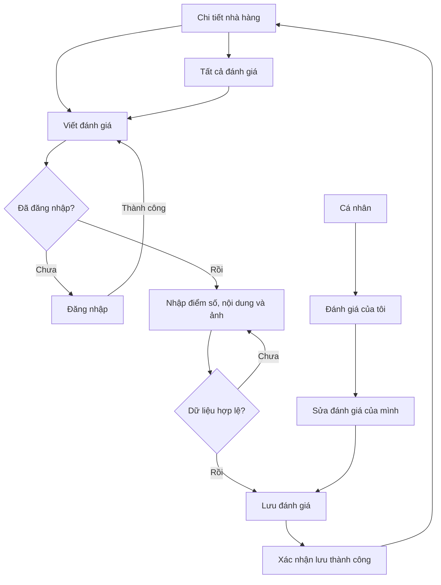
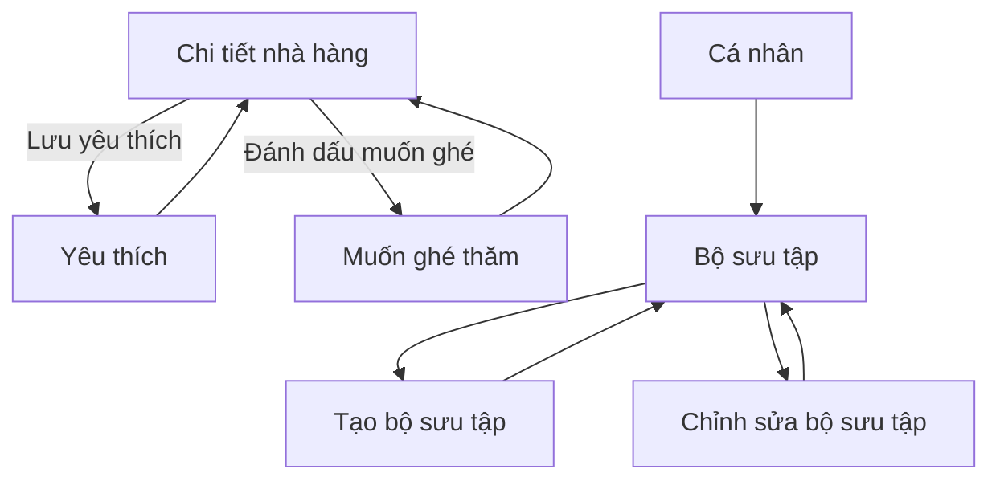
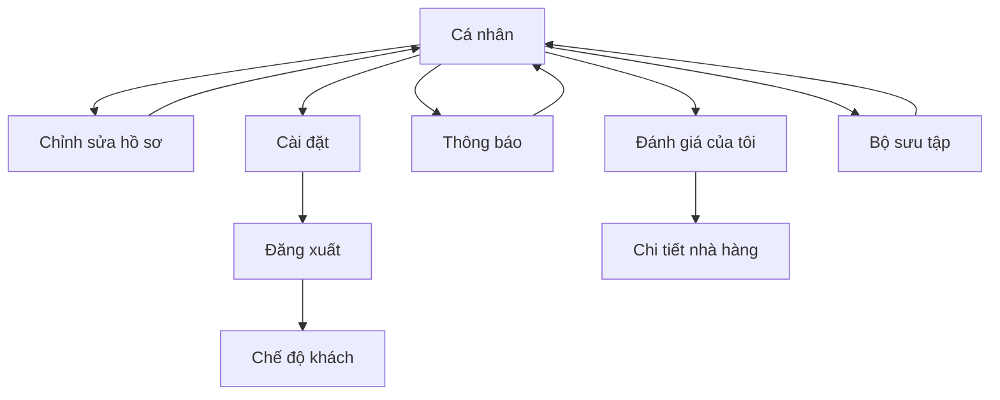
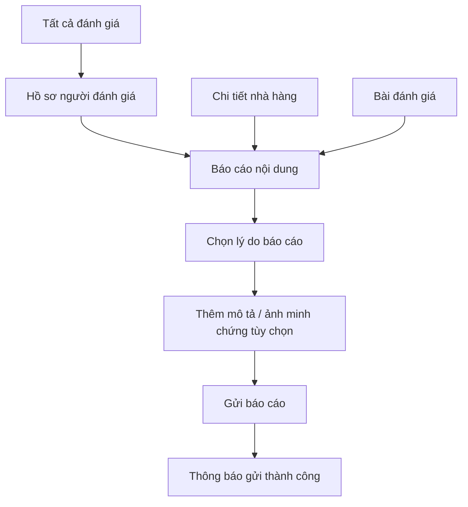
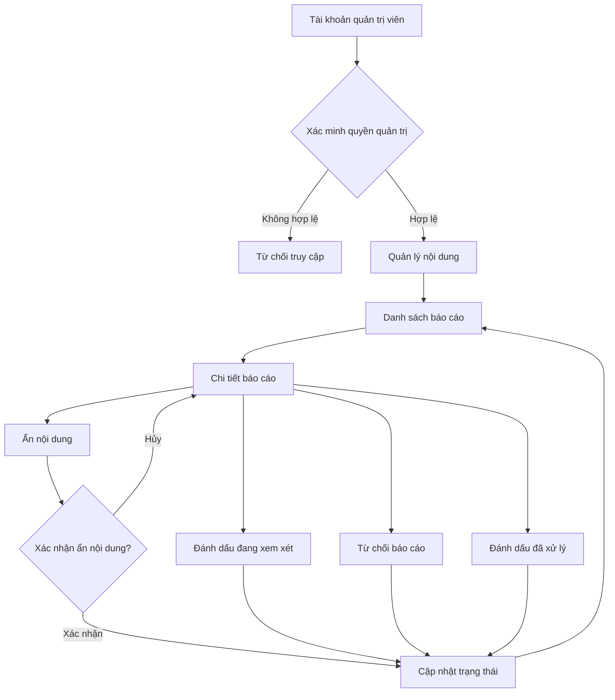

# Food Review — Luồng hoạt động và điều hướng ứng dụng

> Tài liệu đặc tả luồng UI/UX và routing cho ứng dụng Food Review.  
> Phiên bản: 1.0  
> Phạm vi: Các màn hình đã lên kế hoạch, không bao gồm 3 màn hình mở rộng 25, 26, 27 theo quyết định hiện tại.

## 1. Mục tiêu

Tài liệu này mô tả:
- Luồng khởi động và xác thực người dùng.
- Điều hướng giữa 4 tab chính.
- Luồng khám phá nhà hàng, tìm kiếm, bản đồ và danh mục.
- Luồng xem, tạo và chỉnh sửa đánh giá.
- Luồng yêu thích, muốn ghé thăm và bộ sưu tập.
- Luồng hồ sơ cá nhân, thông báo và cài đặt.
- Luồng báo cáo nội dung và khu vực quản trị.
- Quy ước tên route đề xuất cho Flutter.

**Lưu ý:** Đây là thiết kế điều hướng đề xuất dựa trên kế hoạch màn hình trong quá trình trao đổi. Route chưa được triển khai trong mã nguồn. Một số số thứ tự màn hình từng bị trùng hoặc thay đổi, vì vậy hãy dùng tên chức năng/route thay vì số màn hình làm định danh chính.

---

## 2. Cấu trúc điều hướng tổng thể



### Quy tắc đề xuất

- Cho phép người dùng chưa đăng nhập khám phá Trang chủ, tìm kiếm, danh mục, bản đồ và chi tiết nhà hàng.
- Yêu cầu đăng nhập khi người dùng muốn thực hiện hành động gắn với tài khoản, chẳng hạn viết đánh giá, lưu yêu thích, quản lý hồ sơ hoặc bộ sưu tập.
- Nếu cần đăng nhập giữa một luồng, lưu lại đích đến ban đầu và quay về đó sau khi đăng nhập thành công.
- Đăng xuất chỉ kết thúc phiên đăng nhập; không xóa dữ liệu tài khoản hoặc nội dung đã lưu trên backend.

---

## 3. Bốn tab điều hướng chính

Thanh điều hướng dưới cùng gồm:

| Tab | Nhãn hiển thị | Mục đích |
|---|---|---|
| 1 | Trang chủ | Khám phá nhà hàng, nội dung nổi bật và danh mục |
| 2 | Bản đồ | Khám phá nhà hàng theo vị trí |
| 3 | Yêu thích | Truy cập nội dung/nhà hàng đã lưu |
| 4 | Cá nhân | Hồ sơ, đánh giá, thông báo, cài đặt và bộ sưu tập |

### Hành vi của tab

- Chuyển tab không nên làm mất trạng thái điều hướng của tab trước.
- Mỗi tab nên có navigation stack riêng.
- Khi người dùng mở chi tiết nhà hàng từ một tab, nút quay lại trở về đúng màn hình nguồn.
- Dùng `StatefulShellRoute.indexedStack` của GoRouter là một lựa chọn phù hợp để giữ trạng thái các tab.

---

## 4. Luồng khám phá nhà hàng



### Quy tắc

- Trang chủ, tìm kiếm, kết quả danh mục và bản đồ đều có thể mở cùng một màn Chi tiết nhà hàng.
- Dùng một route chi tiết chung, truyền `restaurantId`.
- Bộ lọc và sắp xếp cập nhật kết quả tìm kiếm khi người dùng áp dụng.
- Nút quay lại từ Chi tiết nhà hàng trở về đúng nguồn đã mở màn hình đó.
- Màn Thư viện ảnh có thể nhận `restaurantId` và chỉ số ảnh ban đầu nếu người dùng chọn ảnh cụ thể.

---

## 5. Luồng đánh giá



### Quy tắc

- Người dùng có thể mở danh sách đánh giá từ Chi tiết nhà hàng.
- Người dùng chưa đăng nhập phải đăng nhập trước khi tạo hoặc chỉnh sửa đánh giá.
- Sau đăng nhập, quay lại đúng nhà hàng hoặc hành động đang thực hiện.
- Người dùng chỉ có thể sửa hoặc xóa đánh giá của chính mình.
- Sau khi lưu thành công, cập nhật nội dung liên quan và quay về Chi tiết nhà hàng hoặc danh sách đánh giá theo luồng đã mở.
- Nên có trạng thái loading, lỗi, thành công và xác thực dữ liệu.
- Nếu có ảnh đính kèm, việc tải ảnh và lưu đánh giá cần xử lý lỗi riêng.

---

## 6. Luồng yêu thích, muốn ghé thăm và bộ sưu tập



### Phân biệt dữ liệu

- **Yêu thích:** danh sách nhà hàng người dùng muốn lưu nhanh.
- **Muốn ghé thăm:** danh sách nhà hàng người dùng dự định đến.
- **Bộ sưu tập:** nhóm nhà hàng do người dùng tự tổ chức theo chủ đề.

Không tự động coi ba loại dữ liệu này là một danh sách duy nhất. Một nhà hàng có thể đồng thời nằm trong nhiều danh sách nếu người dùng chủ động chọn.

### Hành vi bộ sưu tập

- Màn Bộ sưu tập hiển thị danh sách bộ sưu tập của người dùng.
- Tạo mới mở màn Trình chỉnh sửa bộ sưu tập ở chế độ tạo.
- Chọn một bộ sưu tập để chỉnh sửa mở cùng màn đó ở chế độ sửa.
- Cần truyền `collectionId` khi sửa.
- Xác thực tên bộ sưu tập và hiển thị trạng thái lưu thành công/thất bại.

---

## 7. Luồng hồ sơ và tài khoản



### Quy tắc

- Chỉnh sửa hồ sơ cập nhật tên hiển thị, ảnh đại diện và các trường hồ sơ được hỗ trợ.
- Đánh giá của tôi chỉ hiển thị đánh giá thuộc tài khoản đang đăng nhập.
- Thông báo có thể hỗ trợ mở nội dung liên quan, ví dụ nhà hàng hoặc đánh giá.
- Cài đặt chứa các tùy chọn tài khoản và ứng dụng phù hợp với phạm vi MVP.
- Khi đăng xuất, xóa token/phiên đăng nhập cục bộ và chuyển về chế độ khách.
- Không xóa tài khoản hoặc dữ liệu backend khi người dùng chỉ chọn đăng xuất.

---

## 8. Luồng hồ sơ người đánh giá và báo cáo



### Quy tắc

- Có thể mở Báo cáo nội dung từ nội dung hoặc hồ sơ có hỗ trợ báo cáo.
- Người dùng phải chọn lý do báo cáo.
- Mô tả và ảnh minh chứng là tùy chọn theo thiết kế hiện tại.
- Sau khi gửi thành công, hiển thị thông báo xác nhận.
- Không khẳng định báo cáo đã được xử lý chỉ vì báo cáo đã được gửi.
- Cần chống gửi lặp khi request đang xử lý và xử lý lỗi mạng.

---

## 9. Luồng quản trị nội dung



### Quy tắc bảo mật

- Quản lý nội dung chỉ dành cho quản trị viên.
- Kiểm tra quyền phải được thực hiện ở backend, không chỉ bằng cách ẩn nút hoặc route trong Flutter.
- Thao tác ẩn nội dung cần hộp thoại xác nhận.
- Không xóa vĩnh viễn nội dung theo mặc định khi xử lý báo cáo.
- Nên lưu dấu vết kiểm duyệt gồm quản trị viên thực hiện, thời điểm và hành động.
- Số liệu báo cáo trong thiết kế Stitch chỉ là dữ liệu minh họa, không phải số liệu thực tế.

---

## 10. Danh sách route đề xuất

Các route dưới đây là quy ước tên cho Flutter, không phải route đã được tạo trong mã nguồn.

| Màn hình | Route |
|---|---|
| Trang chủ | `/home` |
| Đăng nhập | `/login` |
| Đăng ký | `/register` |
| Quên mật khẩu | `/forgot-password` |
| Tìm kiếm | `/search` |
| Bộ lọc | `/search/filters` |
| Kết quả danh mục | `/categories/:categoryId` |
| Chi tiết nhà hàng | `/restaurants/:restaurantId` |
| Tất cả đánh giá | `/restaurants/:restaurantId/reviews` |
| Tạo đánh giá | `/restaurants/:restaurantId/reviews/create` |
| Sửa đánh giá | `/reviews/:reviewId/edit` |
| Thư viện ảnh | `/restaurants/:restaurantId/gallery` |
| Bản đồ | `/map` |
| Yêu thích | `/favorites` |
| Muốn ghé thăm | `/want-to-visit` |
| Hồ sơ cá nhân | `/profile` |
| Chỉnh sửa hồ sơ | `/profile/edit` |
| Đánh giá của tôi | `/my-reviews` |
| Cài đặt | `/settings` |
| Thông báo | `/notifications` |
| Hồ sơ người đánh giá | `/users/:userId` |
| Bộ sưu tập | `/collections` |
| Tạo bộ sưu tập | `/collections/create` |
| Chỉnh sửa bộ sưu tập | `/collections/:collectionId/edit` |
| Tạo báo cáo | `/reports/create` |
| Quản lý nội dung | `/admin/reports` |

### Quy ước tham số

- `restaurantId`: định danh nhà hàng.
- `reviewId`: định danh đánh giá.
- `userId`: định danh hồ sơ người dùng.
- `collectionId`: định danh bộ sưu tập.
- `categoryId`: định danh danh mục.

Ưu tiên truyền ID qua route và tải dữ liệu từ repository/backend. Không phụ thuộc vào dữ liệu mẫu được nhúng trực tiếp trong widget.

---

## 11. Quy tắc quay lại và điều hướng

1. **Back:** quay về màn hình trước trong stack hiện tại.
2. **Mở chi tiết từ nhiều nguồn:** quay lại đúng nguồn, không tự động đưa người dùng về Trang chủ.
3. **Đăng nhập giữa luồng:** giữ đích đến ban đầu; đăng nhập thành công thì tiếp tục luồng nếu quyền truy cập hợp lệ.
4. **Gửi biểu mẫu:** chỉ điều hướng sau khi lưu thành công; nếu lỗi, giữ dữ liệu người dùng đã nhập.
5. **Chuyển tab:** giữ stack và trạng thái của mỗi tab.
6. **Deep link:** nếu hỗ trợ mở link đến nhà hàng hoặc đánh giá, xác thực tham số trước khi tải dữ liệu.
7. **Đăng xuất:** xóa trạng thái phiên cục bộ và điều hướng về chế độ khách.
8. **Route quản trị:** chặn truy cập khi chưa xác minh quyền quản trị.

---

## 12. Gợi ý triển khai Flutter

### Router

Dùng `go_router` để định nghĩa route, nested routes, redirect và guard. Với bốn tab chính, cân nhắc `StatefulShellRoute.indexedStack` để duy trì trạng thái mỗi tab.

### Tổ chức code tham khảo

```text
lib/
├── app/
│   ├── app.dart
│   └── router/
│       ├── app_router.dart
│       ├── route_names.dart
│       └── route_guards.dart
├── core/
│   ├── auth/
│   ├── errors/
│   └── widgets/
├── features/
│   ├── home/
│   ├── search/
│   ├── categories/
│   ├── restaurants/
│   ├── reviews/
│   ├── map/
│   ├── favorites/
│   ├── want_to_visit/
│   ├── profile/
│   ├── notifications/
│   ├── collections/
│   ├── reports/
│   └── admin/
└── main.dart
```

Đây là cấu trúc gợi ý; có thể điều chỉnh theo cấu trúc dự án thực tế.

### Nguyên tắc

- Router chịu trách nhiệm điều hướng, không chứa logic nghiệp vụ lớn.
- Repository/service chịu trách nhiệm đọc và ghi dữ liệu.
- State management quản lý trạng thái loading, success, error và dữ liệu màn hình.
- Không dùng route guard thay cho bảo mật backend.
- Xử lý rõ trạng thái chưa đăng nhập, tài khoản không đủ quyền và dữ liệu không còn tồn tại.

---

## 13. Checklist trước khi bắt đầu code

- [ ] Chốt danh sách màn hình theo tên chức năng; không dựa vào số thứ tự cũ.
- [ ] Chốt chế độ khách có được xem chi tiết nhà hàng hay không.
- [ ] Chốt hành vi sau đăng nhập khi người dùng đang ở một luồng khác.
- [ ] Chốt quy tắc lưu yêu thích và muốn ghé thăm.
- [ ] Chốt quyền tạo, sửa, xóa đánh giá.
- [ ] Chốt quyền riêng tư của bộ sưu tập.
- [ ] Chốt các nguồn có thể mở Báo cáo nội dung.
- [ ] Xác định cơ chế xác minh quyền quản trị ở backend.
- [ ] Chốt `go_router` và cấu trúc tab.
- [ ] Kiểm thử các trạng thái loading, lỗi, dữ liệu rỗng và quay lại.

## 14. Phạm vi

Theo quyết định hiện tại, không triển khai ba màn mở rộng 25, 26, 27. Tài liệu này tập trung vào các luồng khám phá, đánh giá, tài khoản, lưu địa điểm, bộ sưu tập và báo cáo/quản trị đã được thảo luận.

Một số chi tiết như hành vi guest, quyền riêng tư bộ sưu tập và các trạng thái xác thực là đề xuất để hoàn thiện đặc tả; cần xác nhận trước khi triển khai nếu chúng ảnh hưởng đến nghiệp vụ cuối cùng.
